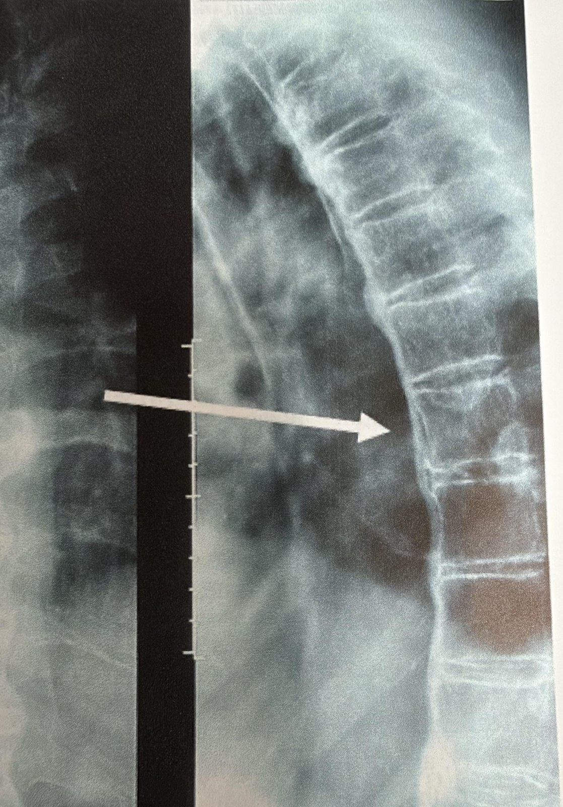

# How doctors assess possible PsA

AI-authored draft. Source-faithfulness and clinical review pending.

Lesson: `psa-dx-01` · Topic: `dx` · About 1 minutes

## Page 1

There is no single test for PsA. A doctor looks at the whole pattern. This is often a rheumatologist, a doctor for joint and immune system diseases. They ask about your symptoms. They ask if psoriasis or PsA runs in your family. They check your joints, skin, and nails. Swollen or tender joints, psoriasis, and nail changes are important signs.

## Page 2

Blood tests help rule out other conditions, such as rheumatoid arthritis. X-rays, ultrasound, or MRI can show changes in joints, the spine, or where tendons attach to bone. See a doctor if joint pain, stiffness, or swelling keeps coming back. Bring a short list of your changes to the visit.

Helliwell P, Coates LC, Gladman D. "Psoriatic Arthritis." In: Stone JH, ed. A Clinician's Pearls & Myths in Rheumatology, 2nd ed. Springer Nature, 2023, chap. 8. © Springer Nature Switzerland AG 2023. Used with permission.

## Key takeaways

- There is no single test for PsA.
- See a doctor if joint pain, stiffness, or swelling keeps coming back.

## Video script

Video: [videos/psa-dx-01.mp4](../videos/psa-dx-01.mp4) (3.1 min) · captions: [videos/psa-dx-01.vtt](../videos/psa-dx-01.vtt)

Style: Whiteboard animation, drawn line by line in time with the narration.

AI voice: en-US-AvaMultilingualNeural (Ava), rate -4%, pitch +2 Hz. Source: Microsoft Edge neural text-to-speech, accessed through the open-source edge-tts Python package (v7). AI-generated voice. Script text was sent to Microsoft's speech service to create the audio.

### Scene 1: Welcome

- Hi there, and welcome! Today, let’s find out how doctors check for possible psoriatic arthritis, or PsA. *(Framing, no medical content)*

### Scene 2: When to get checked

- See a doctor if you have joint pain, stiffness, and swelling that keeps coming back. *(NHS: Psoriatic arthritis)*
- Go even if you do not have psoriasis. These symptoms need to be checked. *(NHS: Psoriatic arthritis)*

### Scene 3: Meet the rheumatologist

- If your doctor thinks you may have PsA, they will send you to a specialist called a rheumatologist. *(NHS: Psoriatic arthritis)*
- A rheumatologist is a doctor who treats joint and immune system diseases. *(Lesson text)*

### Scene 4: No single test

- There is no single test that can prove you have PsA. *(NIAMS: Diagnosis, Treatment, and Steps to Take)*
- Instead, the doctor puts several clues together: your story, an exam, and some tests. *(NIAMS: Diagnosis, Treatment, and Steps to Take)*

### Scene 5: Your symptoms

- First, the doctor talks with you about your symptoms. *(NIAMS: Diagnosis, Treatment, and Steps to Take)*
- For example, PsA symptoms can be worse first thing in the morning, and may get better with exercise. *(NHS: Psoriatic arthritis)*

### Scene 6: Family and skin history

- The doctor will ask if anyone in your family has psoriasis or psoriatic arthritis. *(NIAMS: Diagnosis, Treatment, and Steps to Take)*
- PsA can sometimes start after a person has had psoriasis for many years. *(NHS: Psoriatic arthritis)*

### Scene 7: The physical exam

- Next comes a physical exam. *(NIAMS: Diagnosis, Treatment, and Steps to Take)*
- Swollen or tender joints, psoriasis on the skin, and nail changes are important signs. *(NIAMS: Diagnosis, Treatment, and Steps to Take)*

### Scene 8: Checking the skin

- If you have never been told you have psoriasis, the doctor may check your skin for it. *(NIAMS: Diagnosis, Treatment, and Steps to Take)*

### Scene 9: Where PsA can show up

- PsA can affect the joints, the spine, the skin, and the nails. *(PsA One-Pager Intro)*
- It can also affect places where a tendon or ligament attaches to bone, like the back of the heel. *(PsA One-Pager Intro)*
- Some people get a whole finger or toe that swells up, like a little sausage. *(PsA One-Pager Intro)*

### Scene 10: Nail changes

- Nail changes can include tiny dents, called pitting, or a nail that lifts away from the skin underneath. *(PsA One-Pager Intro)*

### Scene 11: Blood tests

- A blood test helps check for other conditions, such as rheumatoid arthritis. *(NIAMS: Diagnosis, Treatment, and Steps to Take)*
- Other conditions can also cause joint pain, stiffness, and swelling. Examples are osteoarthritis, rheumatoid arthritis, and gout. *(NHS: Psoriatic arthritis)*

### Scene 12: Joint fluid test

- Sometimes, a little fluid is taken from a sore joint and tested. *(NHS: Psoriatic arthritis)*

### Scene 13: Pictures of the inside

- X-rays, ultrasound, or MRI scans can show changes in the joints, the spine, or where tendons attach to bone. *(NIAMS: Diagnosis, Treatment, and Steps to Take)*

### Scene 14: Putting the clues together

- Each test is just one clue. *(Lesson text)*
- The doctor looks at all the clues together to see the whole pattern. *(Lesson text)*

### Scene 15: Be prepared

- It pays to be prepared. *(Murphy’s Laws of Arthritis Preface)*
- Problems like a delay in diagnosis can happen, unless we plan ahead. *(Murphy’s Laws of Arthritis Preface)*
- So bring a short list of your changes, even if they come and go. And note how long stiffness lasts after you wake up. *(Lesson text)*

### Scene 16: Quick review

- Great job! Let’s review. *(Framing, no medical content)*
- There is no single test for PsA. *(Key takeaway)*
- Your doctor puts together your story, an exam, and tests. *(Key takeaway)*
- See a doctor if joint pain, stiffness, or swelling keeps coming back. *(Key takeaway)*

## References and reviewer notes

Brief text; the lesson video carries the detail. Review the diagnostic pathway, including the limits of single test results and the rule-out purpose of blood tests.

- [PsA One-Pager Intro](../../../originals/PsA%20One-Pager%20Intro.jpeg) ? Box A: inflammatory joint/spine/enthesis entry; Box B: skin/nail signs (lesson pages 1, 2; text). Which findings a clinician checks; psoriasis history and multi-area examination. Limits: The testing workflow, the no-single-test statement, the blood-test purpose and the see-a-doctor advice come from NIAMS and NHS, not this poster.
- [Murphy’s Laws of Arthritis Preface](../../../originals/MURPHY%E2%80%99S%20LAWS%20OF%20ARTHRITIS%20%20PREFACE.docx) ? Paragraph 11: preparation and proactive monitoring (lesson pages 1; text). Bring a concise symptom history to the visit. Limits: Only the preparation idea is used. Diagnostic shortcuts in paragraphs 16-18 are not taught.
- [Psoriatic Arthritis: Clinical Images (A Clinician's Pearls & Myths in Rheumatology, ch. 8)](../../../originals/RheumNotes_PsA_Clinical_Images.pdf) ? Clinical images PDF, slides 2-4 (figs. 8.1, 8.2 and the chapter 8 spine X-ray) (lesson pages 2; image). Spine X-ray: shows what an X-ray of the spine looks like. Limits: Example photos from a textbook; a person's own signs may look different. Not a self-diagnosis tool.
- [NIAMS: Diagnosis, Treatment, and Steps to Take](https://www.niams.nih.gov/health-topics/psoriatic-arthritis/diagnosis-treatment-and-steps-to-take)
- [NHS: Psoriatic arthritis](https://www.nhs.uk/conditions/psoriatic-arthritis/)
