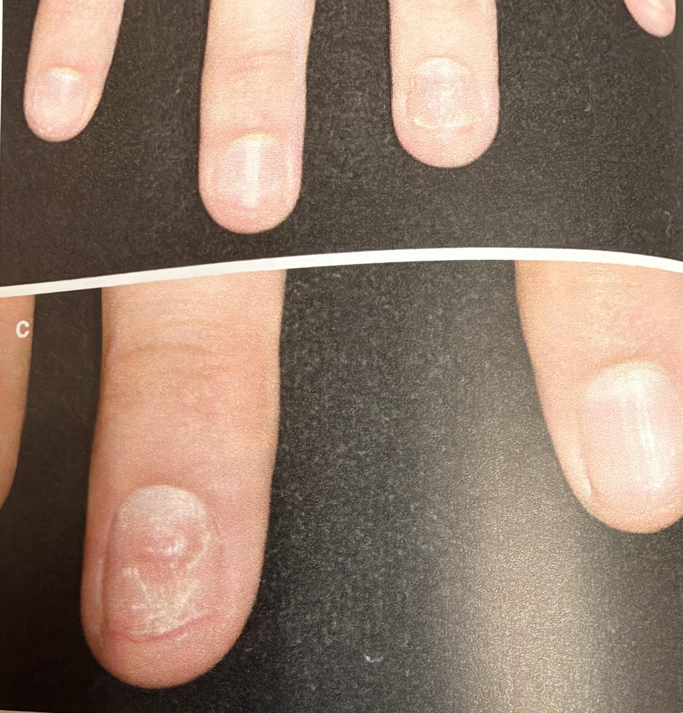
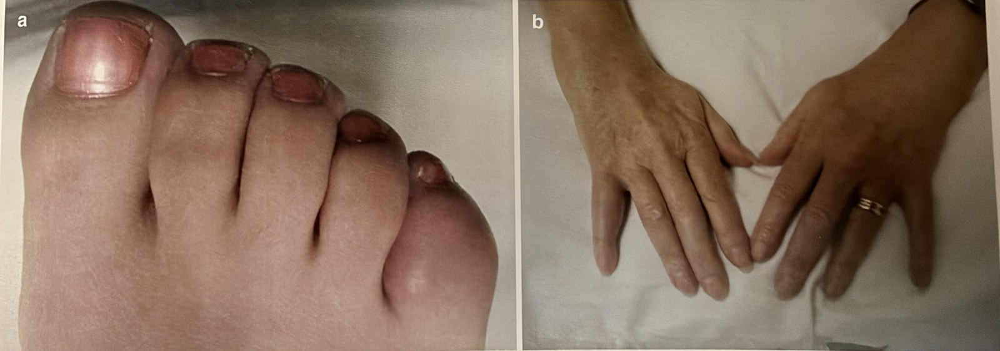

# Understanding the CASPAR framework

AI-authored draft. Source-faithfulness and clinical review pending.

Lesson: `psa-dx-02` · Topic: `dx` · About 1 minutes

## Page 1

CASPAR is a set of rules doctors use to classify PsA. First, there must be inflammation in a joint, the spine, or a tendon attachment. Then other signs are added. Psoriasis you have now counts the most. Psoriasis in the past, or in your family, also counts.

## Page 2

Nail changes count. So does a whole finger or toe that is swollen, now or in the past. A negative test for rheumatoid factor (RF) counts. So does new bone next to a joint on an X-ray. A heel spur alone does not count. A score is not a home diagnosis.

Helliwell P, Coates LC, Gladman D. "Psoriatic Arthritis." In: Stone JH, ed. A Clinician's Pearls & Myths in Rheumatology, 2nd ed. Springer Nature, 2023, fig. 8.1. © Springer Nature Switzerland AG 2023. Used with permission.

Helliwell P, Coates LC, Gladman D. "Psoriatic Arthritis." In: Stone JH, ed. A Clinician's Pearls & Myths in Rheumatology, 2nd ed. Springer Nature, 2023, p. 99, fig. 8.2. © Springer Nature Switzerland AG 2023. Used with permission.

## Key takeaways

- First, there must be inflammation in a joint, the spine, or a tendon attachment.
- A score is not a home diagnosis.

## Video script

Video: [videos/psa-dx-02.mp4](../videos/psa-dx-02.mp4) (2.2 min) · captions: [videos/psa-dx-02.vtt](../videos/psa-dx-02.vtt)

Style: Whiteboard animation, drawn line by line in time with the narration.

AI voice: en-US-AvaMultilingualNeural (Ava), rate -4%, pitch +2 Hz. Source: Microsoft Edge neural text-to-speech, accessed through the open-source edge-tts Python package (v7). AI-generated voice. Script text was sent to Microsoft's speech service to create the audio.

### Scene 1: What is CASPAR?

- Hi again! Let’s learn about CASPAR. *(Framing, no medical content)*
- CASPAR stands for Classification criteria for Psoriatic Arthritis. *(PsA One-Pager Intro)*
- It comes from a study published in 2006. *(PsA One-Pager Intro)*

### Scene 2: Sorting the signs

- Doctors use it to sort the signs of PsA into groups. *(Lesson text)*

### Scene 3: Step one is a must

- Step one is a must. *(Handwritten PsA mind map)*
- There has to be inflammation in a joint, in the spine, or where a tendon attaches to bone. *(Handwritten PsA mind map)*

### Scene 4: Step two adds points

- Step two adds points for other signs. *(Handwritten PsA mind map)*
- There are five groups of signs. *(Handwritten PsA mind map)*

### Scene 5: Group 1: Psoriasis

- Group one is psoriasis. *(PsA One-Pager Intro)*
- Psoriasis on your skin or scalp right now counts the most. *(PsA One-Pager Intro)*
- If you don’t have it now, having had it in the past counts. If you never had it, psoriasis in a close family member counts. *(PsA One-Pager Intro)*

### Scene 6: Group 2: Nail changes

- Group two is nail changes you have now. *(PsA One-Pager Intro)*
- Examples are tiny dents called pitting, a nail lifting off the skin underneath, or thick buildup under the nail. *(PsA One-Pager Intro)*

### Scene 7: Group 3: The RF blood test

- Group three is a blood test called rheumatoid factor, or RF. *(PsA One-Pager Intro)*
- Here, a negative result is the one that counts. *(PsA One-Pager Intro)*

### Scene 8: Group 4: A swollen finger or toe

- Group four is a whole finger or toe that is swollen, sometimes called a sausage digit. *(PsA One-Pager Intro)*
- It counts if it is swollen now, or if a doctor wrote it down in the past. *(PsA One-Pager Intro)*

### Scene 9: Group 5: New bone on an X-ray

- Group five is new bone forming right next to a joint, seen on an X-ray. *(Handwritten PsA mind map)*
- A heel spur alone is not that finding. *(Lesson text)*

### Scene 10: Points are not a home test

- The reference adds up these points. *(Lesson text)*
- But a score is not a home diagnosis. *(Lesson text)*
- A doctor must look at all the findings and check for other causes. *(Lesson text)*

### Scene 11: Talk it through

- Knowing CASPAR can help you follow the conversation with your care team. *(Lesson text)*

### Scene 12: Quick review

- Nice work! Let’s review. *(Framing, no medical content)*
- First, there must be inflammation in a joint, the spine, or a tendon attachment. *(Key takeaway)*
- Psoriasis, nail changes, a negative RF test, a swollen finger or toe, and new bone near a joint can add points. *(Key takeaway)*
- A score is not a home diagnosis. *(Key takeaway)*

## References and reviewer notes

Brief text; the lesson video carries the detail. Confirm the handwritten CASPAR branch and the obscured One-Pager rows clinically. The point threshold is deliberately not taught; no self-diagnosis score is implemented.

- [Handwritten PsA mind map](../../../originals/mindmap.jpeg) ? Right-hand CASPAR branch: entry criterion and five feature groups (lesson pages 1, 2; text). Inflammation first (mandatory); then psoriasis (current weighted most; personal or family history), nail dystrophy, negative RF, dactylitis and juxta-articular new bone. Limits: Handwritten heading says CASPER; use CASPAR. Do not turn this into a self-diagnosis score.
- [PsA One-Pager Intro](../../../originals/PsA%20One-Pager%20Intro.jpeg) ? Box A: CASPAR table (lesson pages 1, 2; text). Current, personal or family psoriasis; nail dystrophy (pitting, onycholysis, hyperkeratosis); negative RF; current or past dactylitis. Limits: Lower table rows are obscured by Box C. Use the mindmap and original CASPAR paper for the new-bone feature.
- [Psoriatic Arthritis: Clinical Images (A Clinician's Pearls & Myths in Rheumatology, ch. 8)](../../../originals/RheumNotes_PsA_Clinical_Images.pdf) ? Clinical images PDF, slides 2-4 (figs. 8.1, 8.2 and the chapter 8 spine X-ray) (lesson pages 2; image). Nail changes and dactylitis photos: two of the signs CASPAR counts. Limits: Example photos from a textbook; a person's own signs may look different. Not a self-diagnosis tool.
- [NIAMS: Diagnosis, Treatment, and Steps to Take](https://www.niams.nih.gov/health-topics/psoriatic-arthritis/diagnosis-treatment-and-steps-to-take)
- [Taylor et al. (2006): original CASPAR classification study](https://pubmed.ncbi.nlm.nih.gov/16871531/)
