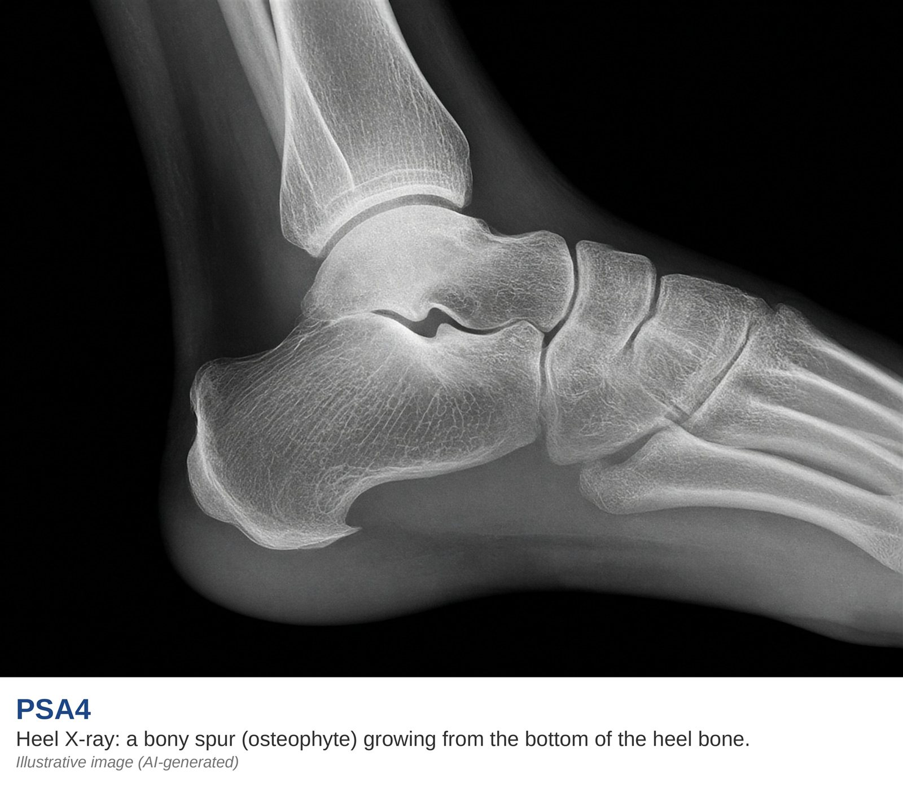

# Understanding the CASPAR framework

AI-authored draft. Source-faithfulness and clinical review pending.

Lesson: `psa-dx-02` · Topic: `dx` · About 2 minutes

## Page 1

CASPAR is a way to group findings for PsA. First, there must be signs of inflammation. These may be in a joint, the spine, or a tendon attachment. Other features are then considered. They include psoriasis now or in the past, or psoriasis in the family. Nail changes and swelling of a whole finger or toe are also part of the framework.

## Page 2

A blood test called rheumatoid factor is one part of the picture. CASPAR also looks for a specific pattern of new bone near a joint on an X-ray. A heel spur alone is not that finding. The reference uses points, but a score is not a home diagnosis. A doctor must assess the findings and check for other causes. Use the framework to follow the discussion with your team. The picture below is an AI-made example of a heel spur. It is not a scan from a patient. It helps show why an image needs a doctor's review.

Supplied image labeled illustrative and AI-generated.

## Key takeaways

- First, there must be signs of inflammation.
- A heel spur alone is not that finding.

## References and reviewer notes

Handwritten CASPAR branch and the obscured One-Pager require clinical confirmation. No numerical score or self-diagnosis tool is implemented.

- [Handwritten PsA mind map](../../../originals/mindmap.jpeg) ? Right-hand CASPAR branch: entry criterion and five feature groups (lesson pages 1, 2; text). Inflammation first, then psoriasis history, nail changes, whole-digit swelling, RF and new bone. Limits: Handwritten heading says CASPER; use CASPAR. Do not turn this into a self-diagnosis score.
- [PsA One-Pager Intro](../../../originals/PsA%20One-Pager%20Intro.jpeg) ? Box A: CASPAR table (lesson pages 1, 2; text). Explains current/past/family psoriasis, nails, RF and dactylitis. Limits: Lower table rows are obscured by Box C. Use the mindmap and original CASPAR paper for the new-bone feature.
- [Heel X-ray with a bony spur (illustrative, AI-generated)](../../../originals/Heel%20X-ray%20with%20a%20bony%20spur%20%28illustrative%2C%20AI-generated%29.jpg) ? PSA4 caption and underside of heel in the illustration (lesson pages 2; image). Visual example of a heel spur accompanying the explanation of imaging limits. Limits: AI-generated illustration, not a real scan; the image does not establish a CASPAR feature.
- [NIAMS: Diagnosis, Treatment, and Steps to Take](https://www.niams.nih.gov/health-topics/psoriatic-arthritis/diagnosis-treatment-and-steps-to-take)
- [Taylor et al. (2006): original CASPAR classification study](https://pubmed.ncbi.nlm.nih.gov/16871531/)
