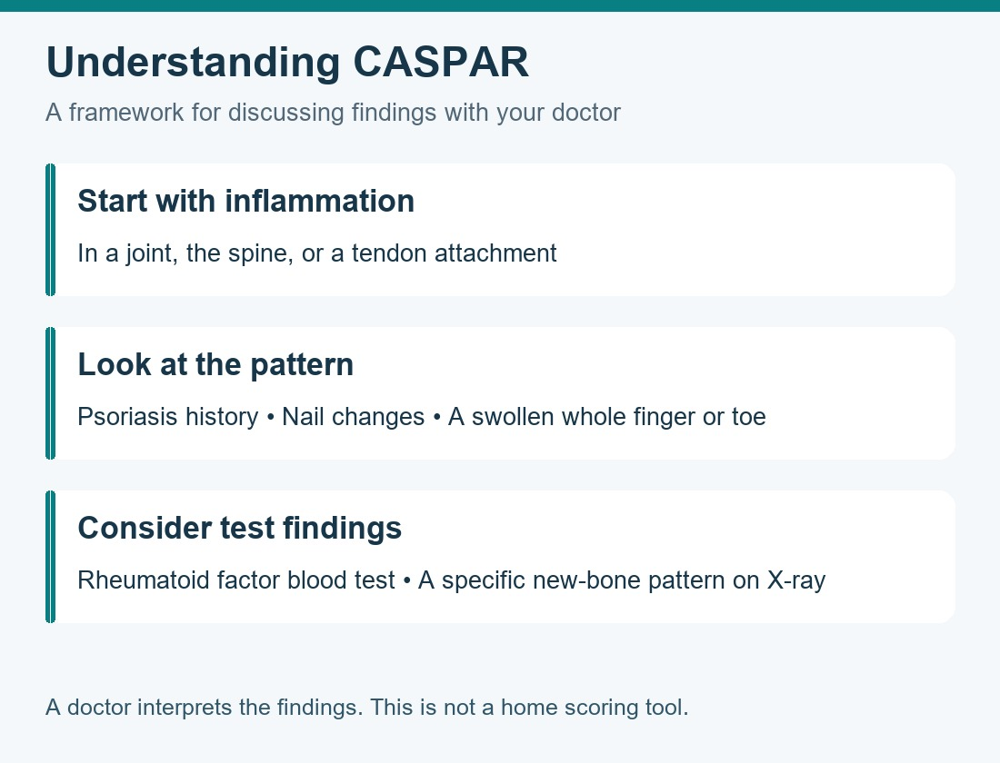

# Understanding the CASPAR framework

AI-authored draft. Source-faithfulness and clinical review pending.

Lesson: `psa-dx-02` · Topic: `dx` · About 2 minutes

## Page 1

CASPAR is a way to group findings for PsA. First, there must be signs of inflammation. These may be in a joint, the spine, or a tendon attachment. Other features are then considered. They include psoriasis now or in the past, or psoriasis in the family. Nail changes and swelling of a whole finger or toe are also part of the framework.

## Page 2

A blood test called rheumatoid factor is one part of the picture. CASPAR also looks for a specific pattern of new bone near a joint on an X-ray. A heel spur alone is not that finding. The reference uses points, but a score is not a home diagnosis. A doctor must assess the findings and check for other causes. Use the framework to follow the discussion with your team.

The diagram groups the findings discussed in this lesson. Read it as a guide to the visit, not a checklist for diagnosing yourself.

Original editorial diagram summarizing the lesson and its cited source material; not a reproduced source figure. Editable SVG: assisted-input/diagrams/caspar-framework.svg. Clinical review pending.

## Key takeaways

- First, there must be signs of inflammation.
- A heel spur alone is not that finding.

## References and reviewer notes

Handwritten CASPAR branch and the obscured One-Pager require clinical confirmation. No numerical score or self-diagnosis tool is implemented. Added image-reading guidance and practical discussion prompts; prompts are editorial examples, not source quotations.

- [Handwritten PsA mind map](../../../originals/mindmap.jpeg) ? Right-hand CASPAR branch: entry criterion and five feature groups; Editorial diagram based on the located source sections and current lesson; diagram spec: caspar-framework (lesson pages 1, 2; text_and_image). Inflammation first, then psoriasis history, nail changes, whole-digit swelling, RF and new bone. Displays a plain-language teaching summary; original diagram, not a source screenshot. Limits: Handwritten heading says CASPER; use CASPAR. Do not turn this into a self-diagnosis score. Diagram omits scoring cutoffs, drug doses, prevalence estimates and individual predictions.
- [PsA One-Pager Intro](../../../originals/PsA%20One-Pager%20Intro.jpeg) ? Box A: CASPAR table (lesson pages 1, 2; text). Explains current/past/family psoriasis, nails, RF and dactylitis. Limits: Lower table rows are obscured by Box C. Use the mindmap and original CASPAR paper for the new-bone feature.
- [NIAMS: Diagnosis, Treatment, and Steps to Take](https://www.niams.nih.gov/health-topics/psoriatic-arthritis/diagnosis-treatment-and-steps-to-take)
- [Taylor et al. (2006): original CASPAR classification study](https://pubmed.ncbi.nlm.nih.gov/16871531/)
