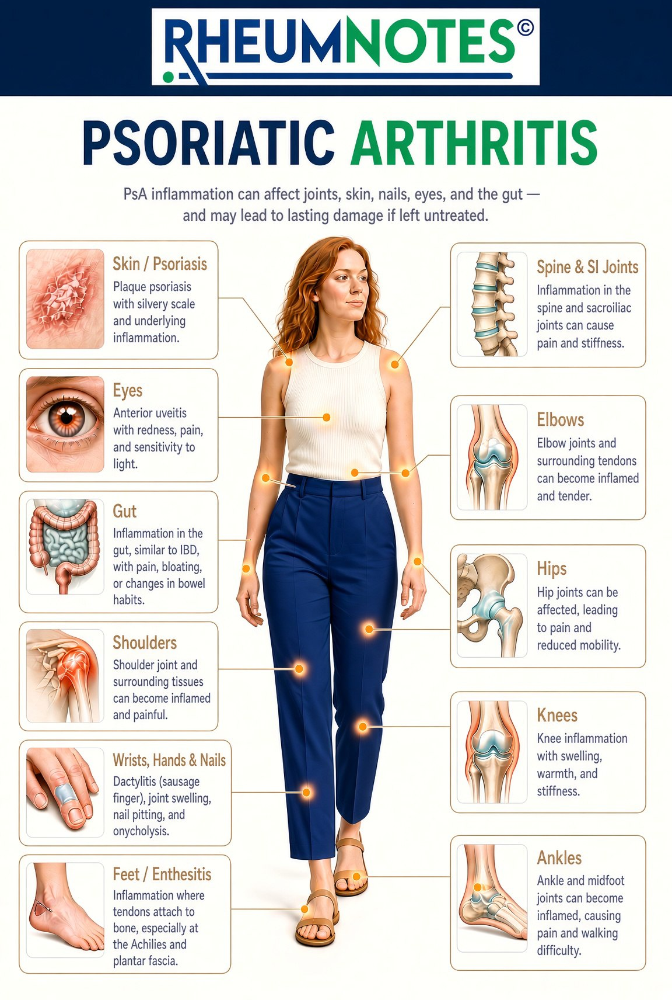

# What PsA is

AI-authored draft. Source-faithfulness and clinical review pending.

Lesson: `psa-overview-01` · Topic: `overview` · About 2 minutes

## Page 1

Psoriatic arthritis, or PsA, is a long-term condition linked to inflammation. The immune system becomes overactive. This can cause pain and swelling in joints and where tendons attach to bone. Psoriasis is a related skin condition that can cause scaly patches. Psoriasis and PsA are linked, but they are not the same condition. Many people have skin psoriasis before joint symptoms begin. Some notice joint symptoms first.

A joint is a place where bones meet. Smooth cartilage covers the bone ends. A thin lining makes fluid that helps the joint move. Tendons join muscle to bone. Ligaments join bone to bone. Knowing these parts can help you describe where you hurt.

Source: supplied RHEUMNOTES poster.

## Page 2

The next lesson groups PsA into six areas, called domains. These are skin, nails, joints away from the spine, the spine, swollen fingers or toes, and tendon attachment sites. You may have changes in some areas and not others. Not everyone has changes in all six areas. Skin and joint changes may follow different patterns. These areas describe the disease. They are not the six topics in this course.

## Key takeaways

- Psoriasis and PsA are linked, but they are not the same condition.
- Not everyone has changes in all six areas.

## Video script

Video: [videos/psa-overview-01.mp4](../videos/psa-overview-01.mp4) (2.1 min) · captions: [videos/psa-overview-01.vtt](../videos/psa-overview-01.vtt)

Style: Whiteboard animation, drawn line by line in time with the narration.

AI voice: en-US-AvaMultilingualNeural (Ava), rate -4%, pitch +2 Hz. Source: Microsoft Edge neural text-to-speech, accessed through the open-source edge-tts Python package (v7). AI-generated voice. Script text was sent to Microsoft's speech service to create the audio.

### Scene 1: Welcome

- Hi there! In this lesson, let’s find out what psoriatic arthritis, or PsA, really is. *(Framing, no medical content)*

### Scene 2: A long-term condition

- PsA is a long-term condition that causes inflammation in the joints, and in the places where tendons and ligaments attach to bone. *(NIAMS: Psoriatic Arthritis)*
- Those attachment places are called entheses. *(NIAMS: Psoriatic Arthritis)*

### Scene 3: An overactive immune system

- In PsA, the immune system becomes overactive, for reasons no one fully understands. *(NIAMS: Psoriatic Arthritis)*
- This creates inflammation, which leads to pain and swelling. *(NIAMS: Psoriatic Arthritis)*

### Scene 4: Linked to psoriasis

- Psoriasis is a related skin condition that can cause scaly patches. *(Lesson text)*
- Most people with PsA already have psoriasis when they are diagnosed. *(NIAMS: Psoriatic Arthritis)*

### Scene 5: Which comes first?

- On average, PsA starts about 7 to 10 years after skin symptoms begin. *(NIAMS: Psoriatic Arthritis)*
- But a small group of people notice joint pain before any skin rash. *(NIAMS: Psoriatic Arthritis)*

### Scene 6: Linked, not the same

- So psoriasis and PsA are linked, but they are not the same condition. *(Lesson text)*

### Scene 7: Who gets PsA?

- Anyone can get PsA. It is most common in adults, and it affects men and women equally. *(NIAMS: Psoriatic Arthritis)*
- Genes play a part. Many people with PsA have family members with the disease. *(NIAMS: Psoriatic Arthritis)*

### Scene 8: Possible triggers

- Things like obesity, infection, injury, or stress may help trigger it. *(NIAMS: Psoriatic Arthritis)*

### Scene 9: Six areas

- Doctors group PsA into six areas, called domains. *(GRAPPA domains in PsA)*
- They are skin, nails, joints away from the spine, the spine, swollen fingers or toes, and tendon attachment sites. *(Lesson text)*

### Scene 10: Everyone is different

- You may have changes in some areas and not others. Not everyone has all six. *(Lesson text)*
- Symptoms vary a lot from person to person. *(NIAMS: Psoriatic Arthritis)*

### Scene 11: Treatment helps

- There is no cure yet, but treatment can slow the disease, ease pain, and protect your joints. *(NIAMS: Psoriatic Arthritis)*
- Early treatment is linked to better results, and less damage. *(NIAMS: Psoriatic Arthritis)*

### Scene 12: Quick review

- Great job! Let’s review. *(Framing, no medical content)*
- Psoriasis and PsA are linked, but they are not the same condition. *(Key takeaway)*
- Not everyone has changes in all six areas. *(Key takeaway)*

## References and reviewer notes

Course overview links to six topics. This lesson introduces PsA; the GRAPPA illustration is inside overview-02 and describes disease domains, not the course topics. The first lesson uses the whole-body PsA poster for a general introduction; the detailed synovial-joint image was removed from this chapter.

- [PsA One-Pager Intro](../../../originals/PsA%20One-Pager%20Intro.jpeg) ? Central PsA title and Box B six core domains (lesson pages 1, 2; text). Introduces PsA and separates the disease domains from the six course topics. Limits: Immune-system explanation and timing of skin/joint symptoms are supplemented by NIAMS.
- [Clinical manifestations of PsA](../../../originals/clinical%20manifestations%20of%20PSA%20written%20at%20an%208th%20grade%20level.png) ? Subtitle and body-area cards (lesson pages 1, 2; text_and_image). Introduces PsA across the body; the complete supplied poster is displayed on lesson page 1 as a general overview. Limits: Not everyone has every manifestation. Eye and gut conditions can occur alongside PsA; the poster is not a diagnostic tool.
- [GRAPPA domains in PsA](../../../originals/GRAPPA%20domains%20in%20PSA%20which%20guide%20treatment%20decisions.png) ? All six domain headings (lesson pages 2; text). Names the six domains in plain language. Limits: Domain labels are not course topic labels.
- [RheumNotes Anatomy White Paper](../../../originals/RheumNotes_Anatomy_White_Paper.pdf) ? PDF pp. 5?6: joint types and tissues (lesson pages 1; text). Plain-language definitions of joint tissues; no detailed anatomy image in this introductory lesson. Limits: General anatomy or daily-care education, not a diagnostic test or a claim of PsA treatment efficacy. Clinical review pending.
- [NIAMS: Psoriatic Arthritis](https://www.niams.nih.gov/health-topics/psoriatic-arthritis)
