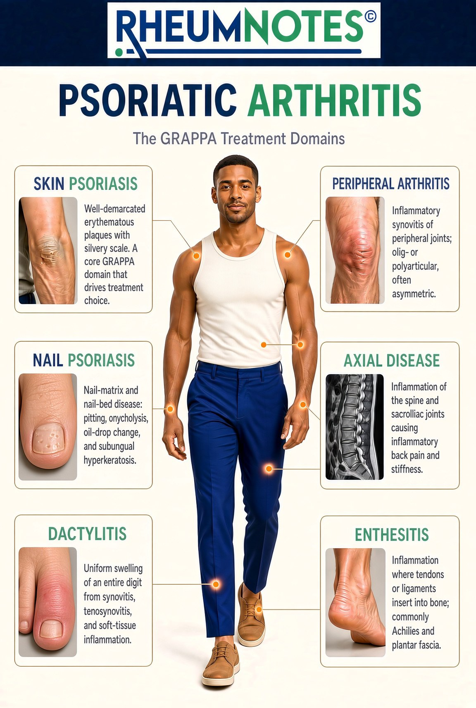

# PsA across the body

AI-authored draft. Source-faithfulness and clinical review pending.

Lesson: `psa-overview-02` · Topic: `overview` · About 2 minutes

## Page 1

The six card labels describe different parts of PsA. Skin psoriasis means scaly skin patches. Nail psoriasis can cause pits or lifting of the nail. Peripheral arthritis affects joints away from the spine, such as those in the hands or knees. Axial disease affects the spine and may involve the joints that join the spine to the pelvis. These are called sacroiliac, or SI, joints.

Source: supplied RHEUMNOTES poster.

## Page 2

Dactylitis means swelling of a whole finger or toe. Enthesitis means inflammation where a tendon or ligament joins bone. The back or bottom of the heel may be affected. These six domains can help guide treatment discussions. They do not name a drug that is right for you. Eye or bowel inflammation can also occur alongside PsA. These are separate from the six domains. Heart health, blood sugar, weight, and mood can also matter in care. The symptoms topic covers these concerns and changes over time.

## Key takeaways

- Dactylitis means swelling of a whole finger or toe.
- These six domains can help guide treatment discussions.

## References and reviewer notes

The GRAPPA poster is a lesson illustration, not the course overview navigation. Six disease domains are distinct from six course topics. Eye/gut conditions and other comorbidities remain separate.

- [GRAPPA domains in PsA](../../../originals/GRAPPA%20domains%20in%20PSA%20which%20guide%20treatment%20decisions.png) ? Six domain cards, including axial disease, dactylitis and enthesitis (lesson pages 1, 2; text_and_image). Defines the six disease domains; displayed on page 1. Limits: Technical poster wording is explained in the lesson; not a drug selection tool.
- [PsA One-Pager Intro](../../../originals/PsA%20One-Pager%20Intro.jpeg) ? Box B: related conditions and comorbidities below six core domains (lesson pages 2; text). Separates eye/bowel conditions and broader health needs from core domains. Limits: Drug preferences in the poster are not copied into a personal treatment plan.
- [Common PsA comorbidities](../../../originals/poster%20of%20the%20comorbidities%20seen%20in%20PSA%20%28top%2010%29.png) ? Card headings: cardiovascular disease, diabetes, obesity, depression (lesson pages 2; text). Introduces heart health, blood sugar, weight and mood. Limits: Numerical prevalence claims are not used; no study population is identified on the image.
- [National Psoriasis Foundation: Related Conditions of Psoriatic Arthritis](https://www.psoriasis.org/psa-related-conditions/)
- [NIAMS: Psoriatic Arthritis](https://www.niams.nih.gov/health-topics/psoriatic-arthritis)
