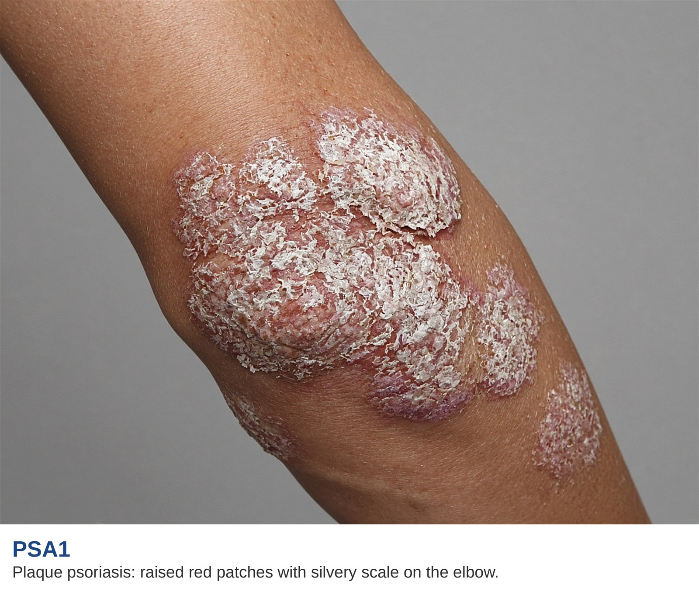

# Skin and psoriasis

AI-authored draft. Source-faithfulness and clinical review pending.

Lesson: `psa-symptoms-01` · Topic: `symptoms` · About 1 minutes

## Page 1

Psoriasis can cause raised skin patches with scales. The skin card on the map shows one example. Patches may appear on the elbows or other parts of the body. Skin changes are one part of PsA care. A skin patch alone cannot show whether a person has joint disease.

## Page 2

The photo below shows scales on an elbow. Use it to learn what the source means by a skin patch. Your skin may look different. Tell your care team about new or changing patches and any joint symptoms. Skin and joint changes do not always happen at the same time.

Supplied educational illustration.

## Key takeaways

- Skin changes are one part of PsA care.
- Your skin may look different.

## References and reviewer notes

Split from the former combined symptom lessons to match the skin card. Original location and source limitations are recorded below. Clinical review and per-claim verification remain pending.

- [Clinical manifestations of PsA](../../../originals/clinical%20manifestations%20of%20PSA%20written%20at%20an%208th%20grade%20level.png) ? skin card on the clinical manifestations body map (lesson pages 1, 2; text). Body location and symptom description for this lesson. Daily-task and reporting examples are editorial explanations. Limits: The image is not a diagnostic or urgency tool; use the external references for clinical assessment and eye urgency.
- [GRAPPA domains in PsA](../../../originals/GRAPPA%20domains%20in%20PSA%20which%20guide%20treatment%20decisions.png) ? skin / corresponding core domain card (lesson pages 1; text). Defines the disease domain in plain words. Limits: No drug choices, risk percentages or self-diagnosis rules are inferred.
- [PsA & AS Symptoms](../../../originals/PsA%20%26%20AS%20Symptoms.jpeg) ? skin body label (lesson pages 1; text). Cross-checks the original body location; the source includes both PsA and AS. Limits: No drug choices, risk percentages or self-diagnosis rules are inferred.
- [Plaque psoriasis of the elbow](../../../originals/Plaque%20psoriasis%20of%20the%20elbow.jpg) ? PSA1 caption and elbow (lesson pages 2; image). Skin patches and scales. Limits: Supplied educational illustration; does not diagnose a patient.
- [NIAMS: Psoriatic Arthritis](https://www.niams.nih.gov/health-topics/psoriatic-arthritis)
- [NIAMS: Diagnosis, Treatment, and Steps to Take](https://www.niams.nih.gov/health-topics/psoriatic-arthritis/diagnosis-treatment-and-steps-to-take)
