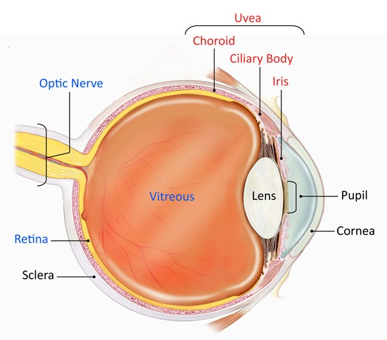

# Eyes and symptoms that need prompt care

AI-authored draft. Source-faithfulness and clinical review pending.

Lesson: `psa-symptoms-02` · Topic: `symptoms` · About 1 minutes

## Page 1

The eyes card describes inflammation inside the eye. One name for this is uveitis. It can cause eye pain, redness, blurred sight, or trouble with bright light. These symptoms can have other causes, too. A body map cannot tell which cause is present.

The picture shows the uvea, a layer inside the eye. It includes the iris, the colored part at the front. Uveitis may affect other parts of the eye, too. The picture shows normal parts, so you cannot use it to judge whether an eye is inflamed.

Courtesy: National Eye Institute, National Institutes of Health (NEI/NIH). Public domain, via Wikimedia Commons. Resized. Source: https://commons.wikimedia.org/wiki/File:EyeDiagramUveitis_0.jpg. Attribution from the existing supplementary-media manifest; copied without further changes.

## Page 2

New eye pain, marked redness, light sensitivity, or blurred sight need urgent assessment. Possible acute eye inflammation needs a same-day eye assessment. Seek emergency care for a loss of vision. Do not wait for your next routine visit or a reply in the app. An eye exam is needed to find the cause.

## Key takeaways

- A body map cannot tell which cause is present.
- Seek emergency care for a loss of vision.

## References and reviewer notes

Split from the former combined symptom lessons to match the eyes card. Original location and source limitations are recorded below. Clinical review and per-claim verification remain pending. Added image-reading guidance and practical discussion prompts; prompts are editorial examples, not source quotations.

- [Clinical manifestations of PsA](../../../originals/clinical%20manifestations%20of%20PSA%20written%20at%20an%208th%20grade%20level.png) ? eyes card on the clinical manifestations body map (lesson pages 1, 2; text). Body location and symptom description for this lesson. Daily-task and reporting examples are editorial explanations. Limits: The image is not a diagnostic or urgency tool; use the external references for clinical assessment and eye urgency.
- [PsA One-Pager Intro](../../../originals/PsA%20One-Pager%20Intro.jpeg) ? Box B and Box C: eyes (lesson pages 1; text). Cross-checks domain or related-condition terminology. Limits: No drug choices, risk percentages or self-diagnosis rules are inferred.
- [PsA & AS Symptoms](../../../originals/PsA%20%26%20AS%20Symptoms.jpeg) ? eyes body label (lesson pages 1; text). Cross-checks the original body location; the source includes both PsA and AS. Limits: No drug choices, risk percentages or self-diagnosis rules are inferred.
- [Diagram of the eye with the part called the uvea labeled.](../../../originals/supplementary/eye-uveitis.jpg) ? Complete supplied supplementary image; https://commons.wikimedia.org/wiki/File:EyeDiagramUveitis_0.jpg (lesson pages 1; text_and_image). Shows the part of the eye where uveitis happens. Explains the labeled uvea and iris; the NEI reference supplements the diagram. Limits: Illustration only; not diagnostic evidence or proof of treatment effect. Photo subjects are not identified as PsA patients or ACCR staff.
- [NHS: Uveitis](https://www.nhs.uk/conditions/uveitis/)
- [NICE NG65, recommendation 1.1.12: same-day eye assessment](https://www.nice.org.uk/guidance/ng65/chapter/recommendations)
- [National Eye Institute: Uveitis — eye anatomy and symptoms](https://www.nei.nih.gov/eye-health-information/eye-conditions-and-diseases/uveitis)
