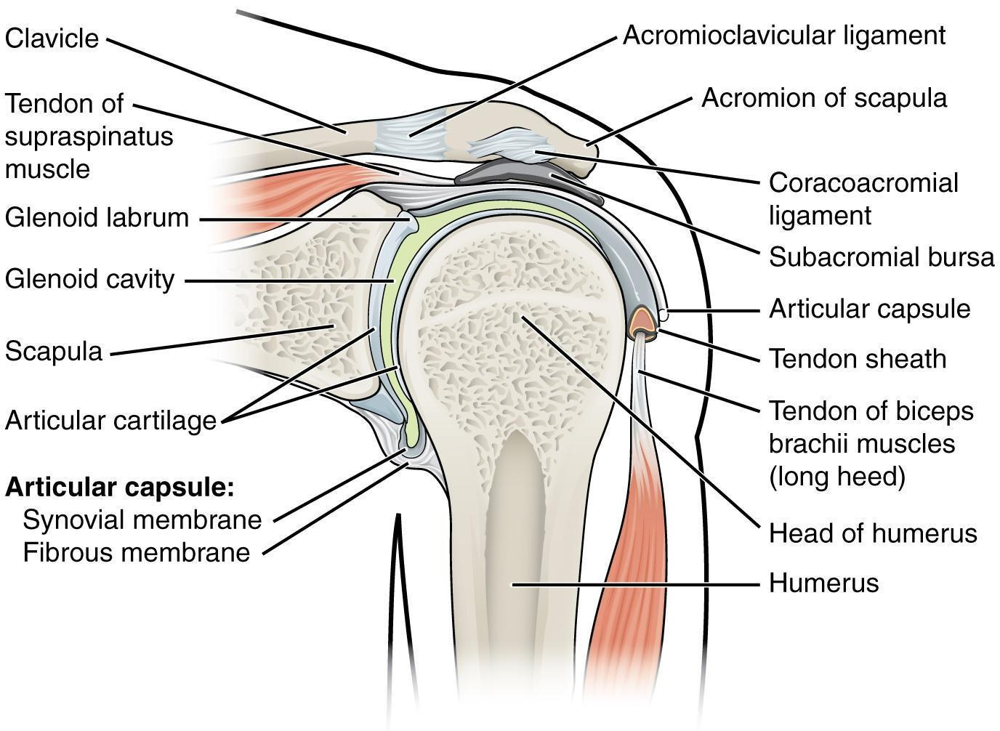

# Shoulders and reaching

AI-authored draft. Source-faithfulness and clinical review pending.

Lesson: `psa-symptoms-05` · Topic: `symptoms` · About 1 minutes

## Page 1

The shoulders card shows that PsA can affect a shoulder joint and nearby tissues. Pain may make it hard to reach up or put on a shirt. A sore shoulder can have more than one cause. The body map shows a place to discuss, not a diagnosis.

The shoulder is a ball in a shallow socket. A group of muscles and tendons called the rotator cuff helps hold it steady as you lift your arm. Small fluid-filled sacs help tissues glide. The picture shows normal parts, not damage from PsA.

OpenStax; CC BY 3.0 (https://creativecommons.org/licenses/by/3.0/). Source: https://commons.wikimedia.org/wiki/File:914_Shoulder_Joint.jpg. Extracted from supplied RheumNotes PDF p. 20; resized and JPEG-compressed, no new crop or labels. Attribution transcribed from the supplied image appendix.

## Page 2

Tell your team which shoulder hurts and when the pain began. Describe a task that has become harder, such as reaching a shelf. Mention stiffness, swelling, or a change in how far you can move. Your team can check the joint and the tissues around it.

## Key takeaways

- A sore shoulder can have more than one cause.
- Describe a task that has become harder, such as reaching a shelf.

## References and reviewer notes

Split from the former combined symptom lessons to match the shoulders card. Original location and source limitations are recorded below. Clinical review and per-claim verification remain pending.

- [Clinical manifestations of PsA](../../../originals/clinical%20manifestations%20of%20PSA%20written%20at%20an%208th%20grade%20level.png) ? shoulders card on the clinical manifestations body map (lesson pages 1, 2; text). Body location and symptom description for this lesson. Daily-task and reporting examples are editorial explanations. Limits: The image is not a diagnostic or urgency tool; use the external references for clinical assessment and eye urgency.
- [PsA & AS Symptoms](../../../originals/PsA%20%26%20AS%20Symptoms.jpeg) ? shoulders body label (lesson pages 1; text). Cross-checks the original body location; the source includes both PsA and AS. Limits: No drug choices, risk percentages or self-diagnosis rules are inferred.
- [RheumNotes Anatomy White Paper](../../../originals/RheumNotes_Anatomy_White_Paper.pdf) ? PDF p. 20: normal regional anatomy; PDF p. 20: displayed illustration; Image Credits appendix (lesson pages 1; text_and_image). Explain normal structures and help locate symptoms. Display the selected source image with attribution. Limits: Normal anatomy only. OA/RA/gout images, exam maneuvers and range-of-motion targets are not used as PsA self-tests.
- [NIAMS: Psoriatic Arthritis](https://www.niams.nih.gov/health-topics/psoriatic-arthritis)
- [NIAMS: Diagnosis, Treatment, and Steps to Take](https://www.niams.nih.gov/health-topics/psoriatic-arthritis/diagnosis-treatment-and-steps-to-take)
