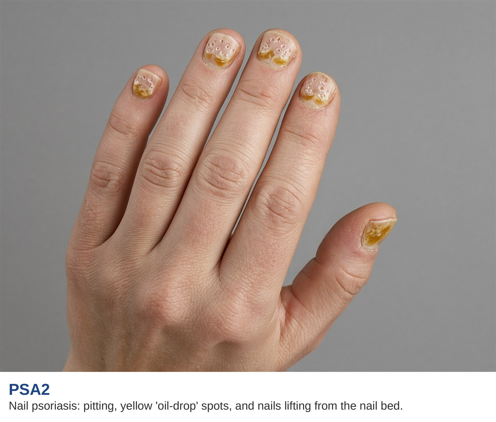

# Wrists, hands, fingers, and nails

AI-authored draft. Source-faithfulness and clinical review pending.

Lesson: `psa-symptoms-06` · Topic: `symptoms` · About 1 minutes

## Page 1

This card groups several changes in the hands. A wrist or finger joint may hurt, swell, or feel stiff. Swelling of a whole finger is called dactylitis. It is different from swelling around just one joint. These changes can make tasks such as holding a cup or using buttons harder.

## Page 2

Nail psoriasis may cause small pits, yellow spots, or a nail lifting from its bed. The photo shows examples of nail changes. Nail changes and joint symptoms do not always happen together. Tell your team whether the change is in a nail, a joint, or the whole finger. Mention any trouble with daily tasks.

Supplied educational illustration.

## Key takeaways

- Swelling of a whole finger is called dactylitis.
- Nail changes and joint symptoms do not always happen together.

## References and reviewer notes

Split from the former combined symptom lessons to match the hands card. Original location and source limitations are recorded below. Clinical review and per-claim verification remain pending.

- [Clinical manifestations of PsA](../../../originals/clinical%20manifestations%20of%20PSA%20written%20at%20an%208th%20grade%20level.png) ? hands card on the clinical manifestations body map (lesson pages 1, 2; text). Body location and symptom description for this lesson. Daily-task and reporting examples are editorial explanations. Limits: The image is not a diagnostic or urgency tool; use the external references for clinical assessment and eye urgency.
- [GRAPPA domains in PsA](../../../originals/GRAPPA%20domains%20in%20PSA%20which%20guide%20treatment%20decisions.png) ? hands / corresponding core domain card (lesson pages 1; text). Defines the disease domain in plain words. Limits: No drug choices, risk percentages or self-diagnosis rules are inferred.
- [PsA One-Pager Intro](../../../originals/PsA%20One-Pager%20Intro.jpeg) ? Box B and Box C: hands (lesson pages 1; text). Cross-checks domain or related-condition terminology. Limits: No drug choices, risk percentages or self-diagnosis rules are inferred.
- [PsA & AS Symptoms](../../../originals/PsA%20%26%20AS%20Symptoms.jpeg) ? hands body label (lesson pages 1; text). Cross-checks the original body location; the source includes both PsA and AS. Limits: No drug choices, risk percentages or self-diagnosis rules are inferred.
- [Nail psoriasis](../../../originals/Nail%20psoriasis.jpg) ? PSA2 caption and nails (lesson pages 2; image). Pits, yellow spots and nail lifting. Limits: Supplied educational illustration; does not diagnose a patient.
- [NIAMS: Psoriatic Arthritis](https://www.niams.nih.gov/health-topics/psoriatic-arthritis)
- [NIAMS: Diagnosis, Treatment, and Steps to Take](https://www.niams.nih.gov/health-topics/psoriatic-arthritis/diagnosis-treatment-and-steps-to-take)
