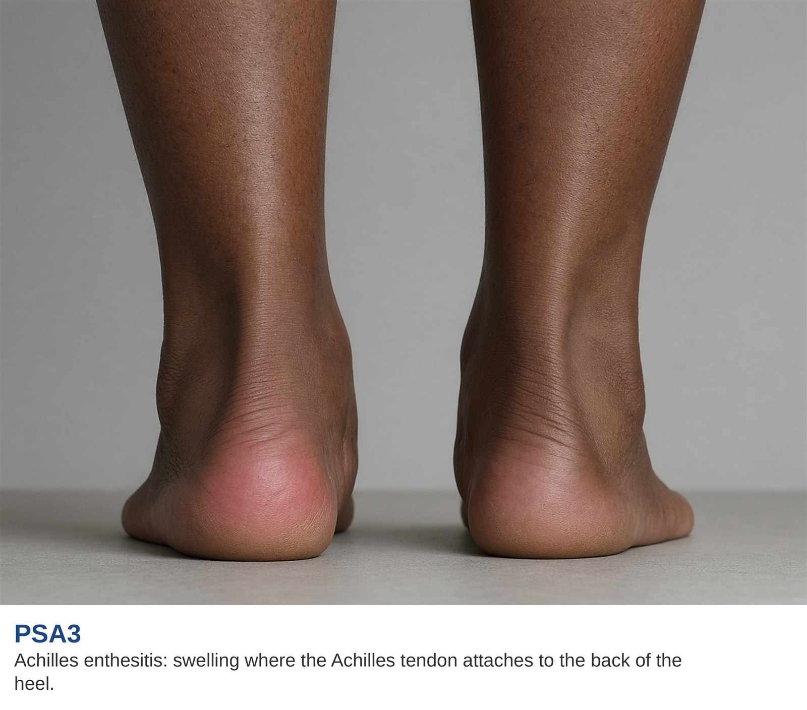
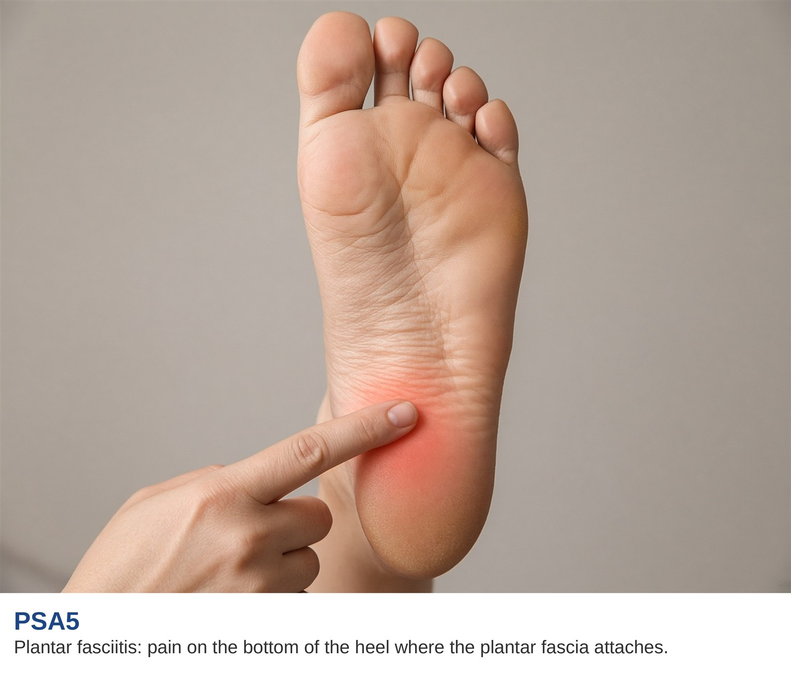

# Feet, heel pain, and tendon attachments

AI-authored draft. Source-faithfulness and clinical review pending.

Lesson: `psa-symptoms-07` · Topic: `symptoms` · About 1 minutes

## Page 1

Enthesitis means inflammation where a tendon or ligament joins bone. The feet card shows this type of change. The Achilles tendon joins the back of the heel. The plantar fascia attaches at the bottom of the heel. These sites can feel sore or tender. The two pictures show the difference in location.

Supplied educational illustration.

Supplied educational illustration.

## Page 2

Tell your team if pain is at the back or bottom of the heel, in a toe, or elsewhere in the foot. Mention whether walking has become harder. Heel pain can have several causes. A symptom picture cannot tell you the cause on its own. Your team can examine the area and decide what to check next.

## Key takeaways

- Heel pain can have several causes.
- A symptom picture cannot tell you the cause on its own.

## References and reviewer notes

Split from the former combined symptom lessons to match the feet card. Original location and source limitations are recorded below. Clinical review and per-claim verification remain pending.

- [Clinical manifestations of PsA](../../../originals/clinical%20manifestations%20of%20PSA%20written%20at%20an%208th%20grade%20level.png) ? feet card on the clinical manifestations body map (lesson pages 1, 2; text). Body location and symptom description for this lesson. Daily-task and reporting examples are editorial explanations. Limits: The image is not a diagnostic or urgency tool; use the external references for clinical assessment and eye urgency.
- [GRAPPA domains in PsA](../../../originals/GRAPPA%20domains%20in%20PSA%20which%20guide%20treatment%20decisions.png) ? feet / corresponding core domain card (lesson pages 1; text). Defines the disease domain in plain words. Limits: No drug choices, risk percentages or self-diagnosis rules are inferred.
- [PsA One-Pager Intro](../../../originals/PsA%20One-Pager%20Intro.jpeg) ? Box B and Box C: feet (lesson pages 1; text). Cross-checks domain or related-condition terminology. Limits: No drug choices, risk percentages or self-diagnosis rules are inferred.
- [PsA & AS Symptoms](../../../originals/PsA%20%26%20AS%20Symptoms.jpeg) ? feet body label (lesson pages 1; text). Cross-checks the original body location; the source includes both PsA and AS. Limits: No drug choices, risk percentages or self-diagnosis rules are inferred.
- [Achilles enthesitis](../../../originals/Achilles%20enthesitis.jpg) ? PSA3 caption and heel backs (lesson pages 1; image). Back-of-heel tendon attachment location. Limits: Supplied educational illustration; does not diagnose a patient.
- [Plantar fasciitis](../../../originals/Plantar%20fasciitis.jpg) ? PSA5 caption and sole (lesson pages 1; image). Bottom-of-heel attachment location. Limits: Supplied educational illustration; does not diagnose a patient.
- [NIAMS: Psoriatic Arthritis](https://www.niams.nih.gov/health-topics/psoriatic-arthritis)
- [NIAMS: Diagnosis, Treatment, and Steps to Take](https://www.niams.nih.gov/health-topics/psoriatic-arthritis/diagnosis-treatment-and-steps-to-take)
