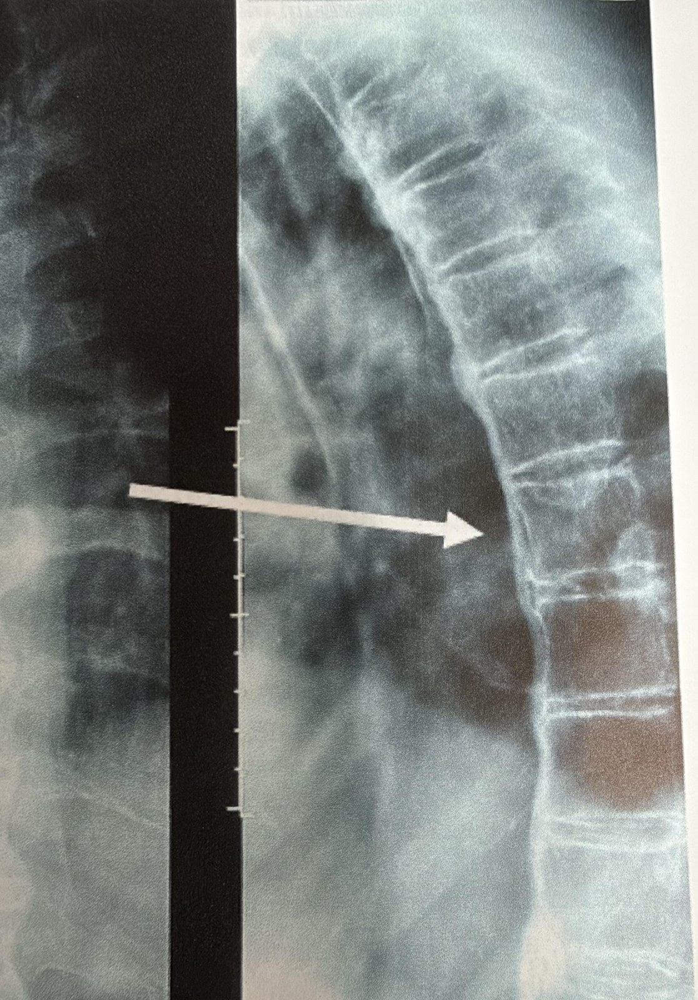

# Spine and SI joints

AI-authored draft. Source-faithfulness and clinical review pending.

Lesson: `psa-symptoms-08` · Topic: `symptoms` · About 1 minutes

## Page 1

Axial disease means PsA affects the spine. It may also affect the sacroiliac, or SI, joints. These joints link the lower spine to the pelvis. Inflammation in these areas can cause back pain and stiffness. The spine card shows where these changes may occur.

Helliwell P, Coates LC, Gladman D. "Psoriatic Arthritis." In: Stone JH, ed. A Clinician's Pearls & Myths in Rheumatology, 2nd ed. Springer Nature, 2023, chap. 8. © Springer Nature Switzerland AG 2023. Used with permission.

## Page 2

Tell your care team where your back feels sore or stiff. Note when it happens and how it affects sleep or movement. Back pain can have many causes. This map cannot show which cause you have. A clinician uses your story, an exam, and sometimes tests to understand the pattern.

## Key takeaways

- Back pain can have many causes.
- These joints link the lower spine to the pelvis.

## Video script

Video: [videos/psa-symptoms-08.mp4](../videos/psa-symptoms-08.mp4) (1.3 min) · captions: [videos/psa-symptoms-08.vtt](../videos/psa-symptoms-08.vtt)

Style: Whiteboard animation, drawn line by line in time with the narration.

AI voice: en-US-AvaMultilingualNeural (Ava), rate -4%, pitch +2 Hz. Source: Microsoft Edge neural text-to-speech, accessed through the open-source edge-tts Python package (v7). AI-generated voice. Script text was sent to Microsoft's speech service to create the audio.

### Scene 1: Welcome

- Let’s look at the spine, and the SI joints. *(Framing, no medical content)*

### Scene 2: Axial disease

- Axial disease means PsA affects the spine. *(Lesson text)*
- It may also affect the sacroiliac, or SI, joints, which link the lower spine to the pelvis. *(Lesson text)*

### Scene 3: How it feels

- Inflammation here can cause stiffness in the neck, the lower back, and the hips. *(NIAMS: Psoriatic Arthritis)*
- Stiffness is often worse in the morning, or after resting. *(NIAMS: Psoriatic Arthritis)*
- And it may get better with exercise. *(NHS: Psoriatic arthritis)*

### Scene 4: Tell your team

- Tell your care team where your back feels sore or stiff. *(Lesson text)*
- Note when it happens, and how it affects sleep or movement. *(Lesson text)*

### Scene 5: Many causes

- Back pain can have many causes, and a map cannot show which one you have. *(Lesson text)*

### Scene 6: Finding the pattern

- A clinician uses your story, an exam, and sometimes tests, to understand the pattern. *(Lesson text)*
- Imaging can show changes in the spine. *(NIAMS: Diagnosis, Treatment, and Steps to Take)*

### Scene 7: Moving helps

- Low-impact exercise, like walking, swimming, yoga, or tai chi, may help. *(NIAMS: Diagnosis, Treatment, and Steps to Take)*
- Talk with your doctor before you start. *(NIAMS: Diagnosis, Treatment, and Steps to Take)*

### Scene 8: Quick review

- Great job! Let’s review. *(Framing, no medical content)*
- Back pain can have many causes. *(Key takeaway)*
- These joints link the lower spine to the pelvis. *(Key takeaway)*

## References and reviewer notes

Split from the former combined symptom lessons to match the spine card. Original location and source limitations are recorded below. Clinical review and per-claim verification remain pending.

- [Clinical manifestations of PsA](../../../originals/clinical%20manifestations%20of%20PSA%20written%20at%20an%208th%20grade%20level.png) ? spine card on the clinical manifestations body map (lesson pages 1, 2; text). Body location and symptom description for this lesson. Daily-task and reporting examples are editorial explanations. Limits: The image is not a diagnostic or urgency tool; use the external references for clinical assessment and eye urgency.
- [GRAPPA domains in PsA](../../../originals/GRAPPA%20domains%20in%20PSA%20which%20guide%20treatment%20decisions.png) ? spine / corresponding core domain card (lesson pages 1; text). Defines the disease domain in plain words. Limits: No drug choices, risk percentages or self-diagnosis rules are inferred.
- [PsA One-Pager Intro](../../../originals/PsA%20One-Pager%20Intro.jpeg) ? Box B and Box C: spine (lesson pages 1; text). Cross-checks domain or related-condition terminology. Limits: No drug choices, risk percentages or self-diagnosis rules are inferred.
- [PsA & AS Symptoms](../../../originals/PsA%20%26%20AS%20Symptoms.jpeg) ? spine body label (lesson pages 1; text). Cross-checks the original body location; the source includes both PsA and AS. Limits: No drug choices, risk percentages or self-diagnosis rules are inferred.
- [Psoriatic Arthritis: Clinical Images (A Clinician's Pearls & Myths in Rheumatology, ch. 8)](../../../originals/RheumNotes_PsA_Clinical_Images.pdf) ? Clinical images PDF, slides 2-4 (figs. 8.1, 8.2 and the chapter 8 spine X-ray) (lesson pages 1; image). Spine X-ray with spondylitis changes. Limits: Example photos from a textbook; a person's own signs may look different. Not a self-diagnosis tool.
- [NIAMS: Psoriatic Arthritis](https://www.niams.nih.gov/health-topics/psoriatic-arthritis)
- [NIAMS: Diagnosis, Treatment, and Steps to Take](https://www.niams.nih.gov/health-topics/psoriatic-arthritis/diagnosis-treatment-and-steps-to-take)
