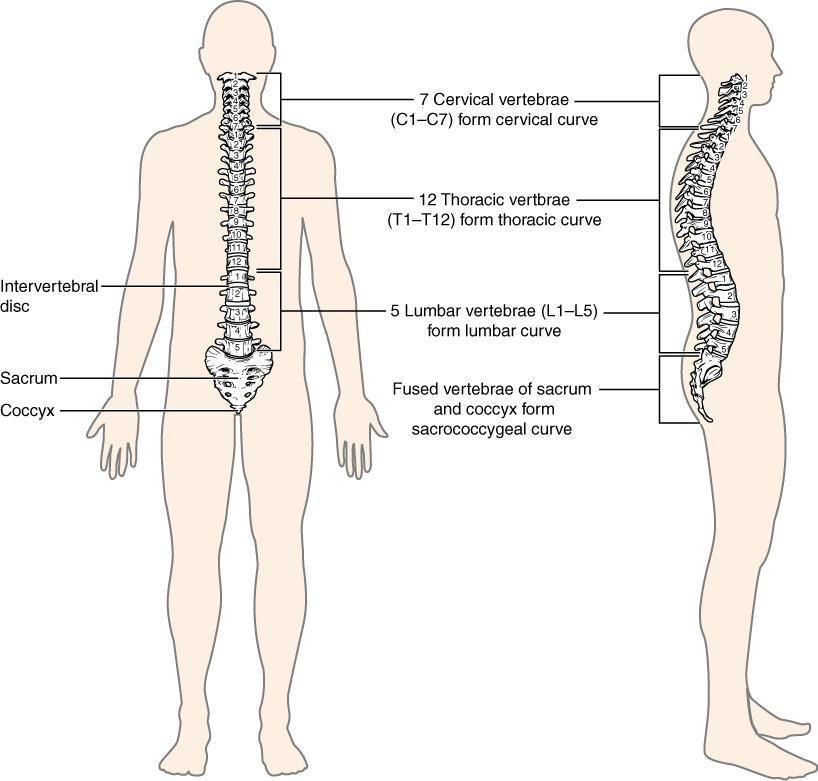

# Spine and SI joints

AI-authored draft. Source-faithfulness and clinical review pending.

Lesson: `psa-symptoms-08` · Topic: `symptoms` · About 1 minutes

## Page 1

Axial disease means PsA affects the spine. It may also affect the sacroiliac, or SI, joints. These joints link the lower spine to the pelvis. Inflammation in these areas can cause back pain and stiffness. The spine card shows where these changes may occur.

The spine is a stack of bones called vertebrae. Discs sit between many of them. The sacrum is the bone at the base of the spine. The SI joints link it to the pelvis. The picture shows normal spine regions; it cannot show the cause of your pain.

OpenStax; CC BY 3.0 (https://creativecommons.org/licenses/by/3.0/). Source: https://commons.wikimedia.org/wiki/File:715_Vertebral_Column.jpg. Extracted from supplied RheumNotes PDF p. 13; resized and JPEG-compressed, no new crop or labels. Attribution transcribed from the supplied image appendix.

## Page 2

Tell your care team where your back feels sore or stiff. Note when it happens and how it affects sleep or movement. Back pain can have many causes. This map cannot show which cause you have. A clinician uses your story, an exam, and sometimes tests to understand the pattern.

## Key takeaways

- Back pain can have many causes.
- These joints link the lower spine to the pelvis.

## References and reviewer notes

Split from the former combined symptom lessons to match the spine card. Original location and source limitations are recorded below. Clinical review and per-claim verification remain pending.

- [Clinical manifestations of PsA](../../../originals/clinical%20manifestations%20of%20PSA%20written%20at%20an%208th%20grade%20level.png) ? spine card on the clinical manifestations body map (lesson pages 1, 2; text). Body location and symptom description for this lesson. Daily-task and reporting examples are editorial explanations. Limits: The image is not a diagnostic or urgency tool; use the external references for clinical assessment and eye urgency.
- [GRAPPA domains in PsA](../../../originals/GRAPPA%20domains%20in%20PSA%20which%20guide%20treatment%20decisions.png) ? spine / corresponding core domain card (lesson pages 1; text). Defines the disease domain in plain words. Limits: No drug choices, risk percentages or self-diagnosis rules are inferred.
- [PsA One-Pager Intro](../../../originals/PsA%20One-Pager%20Intro.jpeg) ? Box B and Box C: spine (lesson pages 1; text). Cross-checks domain or related-condition terminology. Limits: No drug choices, risk percentages or self-diagnosis rules are inferred.
- [PsA & AS Symptoms](../../../originals/PsA%20%26%20AS%20Symptoms.jpeg) ? spine body label (lesson pages 1; text). Cross-checks the original body location; the source includes both PsA and AS. Limits: No drug choices, risk percentages or self-diagnosis rules are inferred.
- [RheumNotes Anatomy White Paper](../../../originals/RheumNotes_Anatomy_White_Paper.pdf) ? PDF p. 13: normal regional anatomy; PDF p. 13: displayed illustration; Image Credits appendix (lesson pages 1; text_and_image). Explain normal structures and help locate symptoms. Display the selected source image with attribution. Limits: Normal anatomy only. OA/RA/gout images, exam maneuvers and range-of-motion targets are not used as PsA self-tests.
- [NIAMS: Psoriatic Arthritis](https://www.niams.nih.gov/health-topics/psoriatic-arthritis)
- [NIAMS: Diagnosis, Treatment, and Steps to Take](https://www.niams.nih.gov/health-topics/psoriatic-arthritis/diagnosis-treatment-and-steps-to-take)
