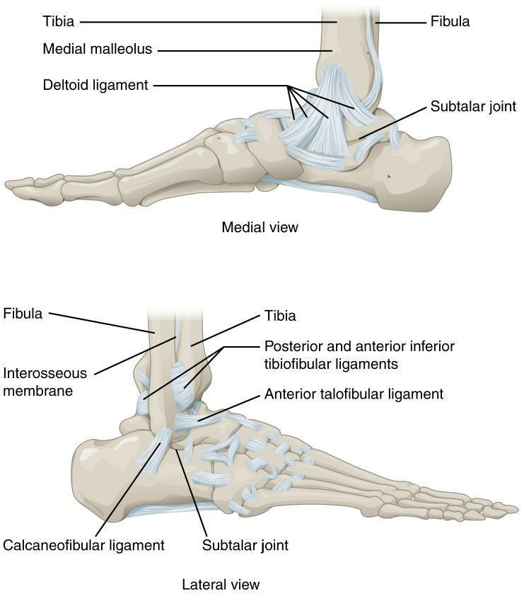

# Ankles and the middle of the foot

AI-authored draft. Source-faithfulness and clinical review pending.

Lesson: `psa-symptoms-12` · Topic: `symptoms` · About 1 minutes

## Page 1

The ankles card describes inflammation in the ankle and middle of the foot. Pain or swelling here can make walking harder. This is different from pain where a tendon joins the heel bone. The Feet and heel lesson explains those attachment sites.

The main ankle joint moves the foot up and down. A joint below it helps the foot tilt on uneven ground. Strong bands on both sides support the ankle. Tell the team whether pain is at the ankle, heel, or middle of the foot.

OpenStax; CC BY 3.0 (https://creativecommons.org/licenses/by/3.0/). Source: https://commons.wikimedia.org/wiki/File:919_Ankle_Feet_Joints.jpg. Extracted from supplied RheumNotes PDF p. 57; resized and JPEG-compressed, no new crop or labels. Attribution transcribed from the supplied image appendix.

## Page 2

Use the map to show where the problem is. Tell your team if it is around the ankle, across the middle of the foot, or at the heel. Mention when it began and any change in walking. The location helps guide an exam. It does not show the cause by itself.

## Key takeaways

- Pain or swelling here can make walking harder.
- It does not show the cause by itself.

## Video script

Video: [videos/psa-symptoms-12.mp4](../videos/psa-symptoms-12.mp4) (1.1 min) · captions: [videos/psa-symptoms-12.vtt](../videos/psa-symptoms-12.vtt)

Style: Whiteboard animation, drawn line by line in time with the narration.

AI voice: en-US-AvaMultilingualNeural (Ava), rate -4%, pitch +2 Hz. Source: Microsoft Edge neural text-to-speech, accessed through the open-source edge-tts Python package (v7). AI-generated voice. Script text was sent to Microsoft's speech service to create the audio.

### Scene 1: Welcome

- Let’s look at the ankles, and the middle of the foot. *(Framing, no medical content)*

### Scene 2: Ankle and mid-foot

- The ankle and the middle of the foot can become inflamed. *(Clinical manifestations of PsA)*
- This can cause pain, and make walking harder. *(Clinical manifestations of PsA)*

### Scene 3: Not the heel

- This is different from pain where a tendon joins the heel bone. *(Lesson text)*
- The feet and heel lesson covers those spots. *(Lesson text)*

### Scene 4: Show where

- Use the map to show where the problem is: around the ankle, across the middle of the foot, or at the heel. *(Lesson text)*

### Scene 5: Tell your team

- Mention when it began, and any change in walking. *(Lesson text)*

### Scene 6: Location is a clue

- The location helps guide an exam. *(Lesson text)*
- But it does not show the cause by itself. *(Lesson text)*

### Scene 7: Your helpers

- Physical therapists help improve joint function. *(NIAMS: Diagnosis, Treatment, and Steps to Take)*
- Occupational therapists teach ways to protect your joints, and save energy. *(NIAMS: Diagnosis, Treatment, and Steps to Take)*

### Scene 8: Quick review

- Great job! Let’s review. *(Framing, no medical content)*
- Pain or swelling here can make walking harder. *(Key takeaway)*
- It does not show the cause by itself. *(Key takeaway)*

## References and reviewer notes

Split from the former combined symptom lessons to match the ankles card. Original location and source limitations are recorded below. Clinical review and per-claim verification remain pending.

- [Clinical manifestations of PsA](../../../originals/clinical%20manifestations%20of%20PSA%20written%20at%20an%208th%20grade%20level.png) ? ankles card on the clinical manifestations body map (lesson pages 1, 2; text). Body location and symptom description for this lesson. Daily-task and reporting examples are editorial explanations. Limits: The image is not a diagnostic or urgency tool; use the external references for clinical assessment and eye urgency.
- [PsA & AS Symptoms](../../../originals/PsA%20%26%20AS%20Symptoms.jpeg) ? ankles body label (lesson pages 1; text). Cross-checks the original body location; the source includes both PsA and AS. Limits: No drug choices, risk percentages or self-diagnosis rules are inferred.
- [RheumNotes Anatomy White Paper](../../../originals/RheumNotes_Anatomy_White_Paper.pdf) ? PDF p. 57: normal regional anatomy; PDF p. 57: displayed illustration; Image Credits appendix (lesson pages 1; text_and_image). Explain normal structures and help locate symptoms. Display the selected source image with attribution. Limits: Normal anatomy only. OA/RA/gout images, exam maneuvers and range-of-motion targets are not used as PsA self-tests.
- [NIAMS: Psoriatic Arthritis](https://www.niams.nih.gov/health-topics/psoriatic-arthritis)
- [NIAMS: Diagnosis, Treatment, and Steps to Take](https://www.niams.nih.gov/health-topics/psoriatic-arthritis/diagnosis-treatment-and-steps-to-take)
