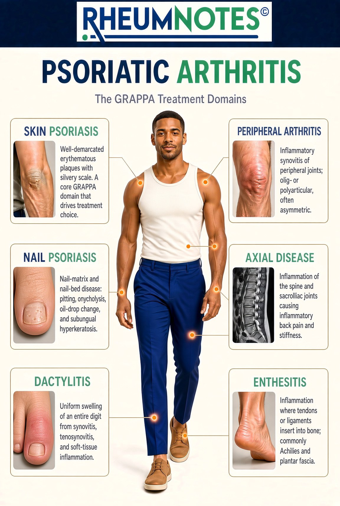

# How treatment goals are chosen

AI-authored draft. Source-faithfulness and clinical review pending.

Lesson: `psa-treatment-01` · Topic: `treatment` · About 1 minutes

## Page 1

Treatment discussions start with what is active and what matters to you. The six disease domains help describe this. They include skin, nails, joints away from the spine, the spine, whole-digit swelling, and attachment sites. The care team considers these domains together. The image is a guide to what needs attention. It is not a list of medicines or a treatment order.

Source: supplied RHEUMNOTES poster.

## Page 2

Goals may include easing symptoms, protecting joints, and making daily tasks easier. Eye or bowel disease and other health conditions also matter. The team asks what you have tried before. They review your other medicines, side effects, and what matters to you. A treatment plan is chosen for a person, rather than from one symptom alone. A medicine that helps one domain may not cover every concern equally. Ask which parts of your disease the plan addresses and how progress will be checked.

## Key takeaways

- The care team considers these domains together.
- A treatment plan is chosen for a person, rather than from one symptom alone.

## References and reviewer notes

Uses the GRAPPA poster as a domain framework, not as a treatment algorithm. No image-only drug selection, dose advice, or claims that all medicines cover all domains.

- [PsA One-Pager Intro](../../../originals/PsA%20One-Pager%20Intro.jpeg) ? Box B domains; related conditions; comorbidities that steer the drug (lesson pages 1, 2; text). Choice considers active domains plus eye, bowel and other health needs. Limits: Do not copy the abbreviated drug rules as patient instructions.
- [GRAPPA domains in PsA](../../../originals/GRAPPA%20domains%20in%20PSA%20which%20guide%20treatment%20decisions.png) ? Six GRAPPA treatment domain cards (lesson pages 1; text_and_image). Shows the six areas considered in goal setting. Limits: Domain overview only, not a ranked treatment pathway.
- [Management Guidelines of Arthritis and Autoimmune Diseases](../../../originals/Management%20Guidelines%20of%20Arthritis%20and%20Autoimmune%20Diseases.docx) ? Paragraphs 33, 38 and 95: matching therapy, monitoring and partnership (lesson pages 2; text). Individual response, other illnesses and follow-up shape the plan. Limits: This broad arthritis chapter includes RA, lupus and OA. Those disease-specific regimens are not treated as PsA guidance.
- [NIAMS: Diagnosis, Treatment, and Steps to Take](https://www.niams.nih.gov/health-topics/psoriatic-arthritis/diagnosis-treatment-and-steps-to-take)
- [GRAPPA 2021 domain-based treatment recommendations (published 2022)](https://www.nature.com/articles/s41584-022-00798-0)
