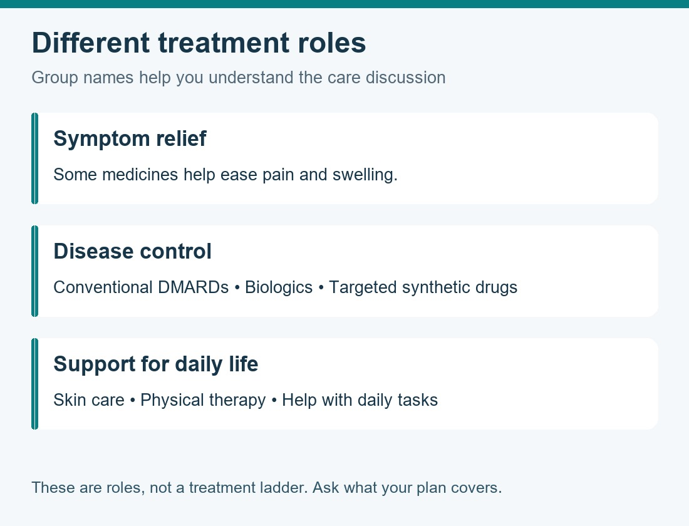

# Understanding treatment groups

AI-authored draft. Source-faithfulness and clinical review pending.

Lesson: `psa-treatment-02` · Topic: `treatment` · About 2 minutes

## Page 1

Medicines have different jobs. Some help ease pain and swelling. Others aim to control the disease process. These are called DMARDs. Conventional DMARDs act broadly on the immune system. Biologic drugs target selected immune signals. Targeted synthetic drugs act on pathways inside cells. These are names for groups. They do not rank drugs from good to bad. Some drugs are pills. Others are given by a shot or through a vein. How a drug enters the body does not tell you how well it will work for you.

The diagram groups care by its role. The groups can be part of the same plan; they are not steps you move through on your own.

Original editorial diagram summarizing the lesson and its cited source material; not a reproduced source figure. Editable SVG: assisted-input/diagrams/treatment-groups.svg. Clinical review pending.

## Page 2

A drug is not right for every person or every disease domain. Some plans also include skin care, physical therapy, or help with daily tasks. The benefits, risks, and checks depend on the drug. This lesson does not give doses or tell you to start, stop, or change a medicine. Ask the prescribing team what your drug is for. Ask which checks go with it, too. Make a list of all your drugs and supplements. Ask about blood tests, infection checks, and vaccines that may go with your plan. Keep follow-up visits even when you feel better.

## Key takeaways

- Medicines have different jobs.
- They do not rank drugs from good to bad.

## References and reviewer notes

DOCX class definitions are background only. Doses, brands, regulatory claims, comparative efficacy, and investigational treatments are omitted. Added image-reading guidance and practical discussion prompts; prompts are editorial examples, not source quotations.

- [Management Guidelines of Arthritis and Autoimmune Diseases](../../../originals/Management%20Guidelines%20of%20Arthritis%20and%20Autoimmune%20Diseases.docx) ? Paragraphs 29, 38-39, 47 and 51: DMARDs, biologics, targeted oral drugs and monitoring; Editorial diagram based on the located source sections and current lesson; diagram spec: treatment-groups (lesson pages 1, 2; text_and_image). Explains drug group roles, routes and questions about follow-up checks. Displays a plain-language teaching summary; original diagram, not a source screenshot. Limits: No doses, new approval claims, investigational therapies or RA/OA treatments imported. Diagram omits scoring cutoffs, drug doses, prevalence estimates and individual predictions.
- [PsA One-Pager Intro](../../../originals/PsA%20One-Pager%20Intro.jpeg) ? Box B: why domains and related conditions change therapy (lesson pages 2; text). Explains why a drug is not right for every domain or person. Limits: No individual drug choice is inferred from one poster row.
- [Handwritten PsA mind map](../../../originals/mindmap.jpeg) ? Bottom treatment branches: DMARDs, biologic DMARDs, PDE4 and JAK pathways (lesson pages 1; text). Connects the original treatment map to the three plain-language group descriptions. Limits: Do not reproduce brand lists, truncated TYK2 branch or a prescribing sequence.
- [NIAMS: Diagnosis, Treatment, and Steps to Take](https://www.niams.nih.gov/health-topics/psoriatic-arthritis/diagnosis-treatment-and-steps-to-take)
- [GRAPPA 2021 domain-based treatment recommendations (published 2022)](https://www.nature.com/articles/s41584-022-00798-0)
