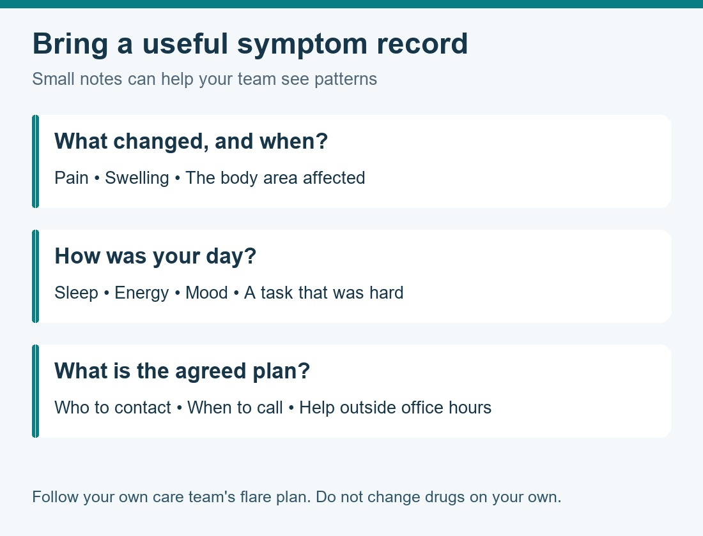

# Tracking progress and planning for flares

AI-authored draft. Source-faithfulness and clinical review pending.

Lesson: `psa-treatment-03` · Topic: `treatment` · About 2 minutes

## Page 1

Follow-up visits look at more than one sign of disease activity. The team may check sore or swollen joints, skin, and tendon sites. They also ask about daily tasks. Your view of pain and health matters, too. Minimal disease activity, or MDA, uses several measures together. It helps track care. It is not a stage of disease. A quiet skin patch alone does not show the whole picture.

## Page 2

If symptoms return or worsen, discuss a flare plan with the care team. A short record can note what changed, when it began, and how it affects daily tasks. Ask which changes need a call, which contact route to use, and what to do outside office hours. Repeated flares may mean the plan needs review. Use instructions agreed with your prescribing team for medicine questions. This general lesson does not replace your own flare plan. A useful record can include pain, sleep, energy, mood, and one task that was hard that day. Share patterns at follow-up visits. This can help the team see changes that a single visit may miss.

Use the diagram to plan a short record. You do not need to give yourself a disease score. Ask the team how they want you to share changes.

Original editorial diagram summarizing the lesson and its cited source material; not a reproduced source figure. Editable SVG: assisted-input/diagrams/flare-record.svg. Clinical review pending.

## Key takeaways

- Follow-up visits look at more than one sign of disease activity.
- If symptoms return or worsen, discuss a flare plan with the care team.

## References and reviewer notes

MDA numerical thresholds from handwriting are not reproduced. Clinic-specific flare actions and contact details remain to be supplied. Added image-reading guidance and practical discussion prompts; prompts are editorial examples, not source quotations.

- [Handwritten PsA mind map](../../../originals/mindmap.jpeg) ? Lower-middle MDA branch: joints, entheses, skin, pain, patient view and function (lesson pages 1; text). Explains multi-measure follow-up rather than judging control from skin alone. Limits: No self-scoring cutoffs; does not represent a disease stage.
- [Murphy’s Laws of Arthritis Preface](../../../originals/MURPHY%E2%80%99S%20LAWS%20OF%20ARTHRITIS%20%20PREFACE.docx) ? Paragraphs 11 and 17: contingency plans and PsA MDA (lesson pages 1, 2; text). Preparation for flares and clinician-led disease activity review. Limits: Does not supply exact clinic response times or a personal flare plan.
- [The Four Pillars of Arthritis](../../../originals/The%20Four%20Pillars%20of%20Arthritis.docx) ? Paragraph 85: tracking pain, energy, mood, sleep and daily tasks; Editorial diagram based on the located source sections and current lesson; diagram spec: flare-record (lesson pages 2; text_and_image). Adds a practical multi-part symptom record. Displays a plain-language teaching summary; original diagram, not a source screenshot. Limits: No fasting advice or guaranteed symptom improvement. Diagram omits scoring cutoffs, drug doses, prevalence estimates and individual predictions.
- [National Psoriasis Foundation: Care Path, Keep Thriving](https://www.psoriasis.org/care-path-thrive/)
