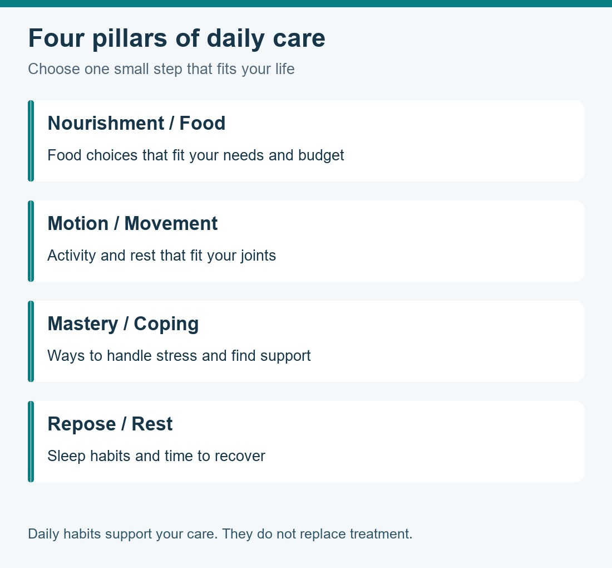

# The four pillars of daily care

AI-authored draft. Source-faithfulness and clinical review pending.

Lesson: `psa-education-01` · Topic: `education` · About 2 minutes

## Page 1

Four pillars can help organize daily life with arthritis: Nourishment, Motion, Mastery, and Repose. In plain words, these mean food, movement, coping, and rest. They are a way to plan a discussion about everyday needs. They do not replace medical treatment. This framework is a guide to daily habits. It is not a test of how well your disease is controlled.

The four panels are equal parts of a daily-care plan. Start with the part that matters most to you now.

Original editorial diagram summarizing the lesson and its cited source material; not a reproduced source figure. Editable SVG: assisted-input/diagrams/four-pillars.svg. Clinical review pending.

## Page 2

Think about which part of daily life is hardest right now. Food choices, activity, mood, and sleep may each raise different questions. A practical plan can focus on a small change that fits your needs and abilities. The care team can help tailor it. Bring up barriers such as pain, cost, fatigue, or poor sleep. Daily care works best as part of a shared plan, rather than as a test of willpower. Start with one small step you choose with your team. For example, plan a short walk that fits your joints, or set aside time to wind down before bed. Notice how the step fits into your day. You can adjust it as your needs change.

You can plan, choose what matters most, break tasks into smaller parts, and use tools or positions that ease strain. For example, split chores across the week and sit for a task when standing is hard.

## Key takeaways

- They do not replace medical treatment.
- The care team can help tailor it.

## References and reviewer notes

Framework from DOCX headings and paragraphs 9, 10, 48, 65, 75, 82. No PsA-specific efficacy is inferred from RA or OA studies. Added image-reading guidance and practical discussion prompts; prompts are editorial examples, not source quotations.

- [The Four Pillars of Arthritis](../../../originals/The%20Four%20Pillars%20of%20Arthritis.docx) ? Paragraph 8; headings at 10, 48, 65, 75; synthesis 83-85; Editorial diagram based on the located source sections and current lesson; diagram spec: four-pillars (lesson pages 1, 2; text_and_image). Four named pillars, plain-language meanings and choosing one small step. Displays a plain-language teaching summary; original diagram, not a source screenshot. Limits: A daily-care framework, not validated PsA disease scoring or a replacement for treatment. Diagram omits scoring cutoffs, drug doses, prevalence estimates and individual predictions.
- [Murphy’s Laws of Arthritis Preface](../../../originals/MURPHY%E2%80%99S%20LAWS%20OF%20ARTHRITIS%20%20PREFACE.docx) ? Paragraphs 11, 18 and 21: preparation, foundations and partnership (lesson pages 2; text). Simple habits and shared planning. Limits: Historical anecdotes and diagnostic parsimony are not taught as clinical rules.
- [RheumNotes Motion White Paper](../../../originals/RheumNotes_Motion_White_Paper.pdf) ? PDF pp. 21–22: pacing and small goals (lesson pages 2; text). Practical pacing examples without an exercise dose. Limits: General anatomy or daily-care education, not a diagnostic test or a claim of PsA treatment efficacy. Clinical review pending.
- [NIAMS: Diagnosis, Treatment, and Steps to Take](https://www.niams.nih.gov/health-topics/psoriatic-arthritis/diagnosis-treatment-and-steps-to-take)
