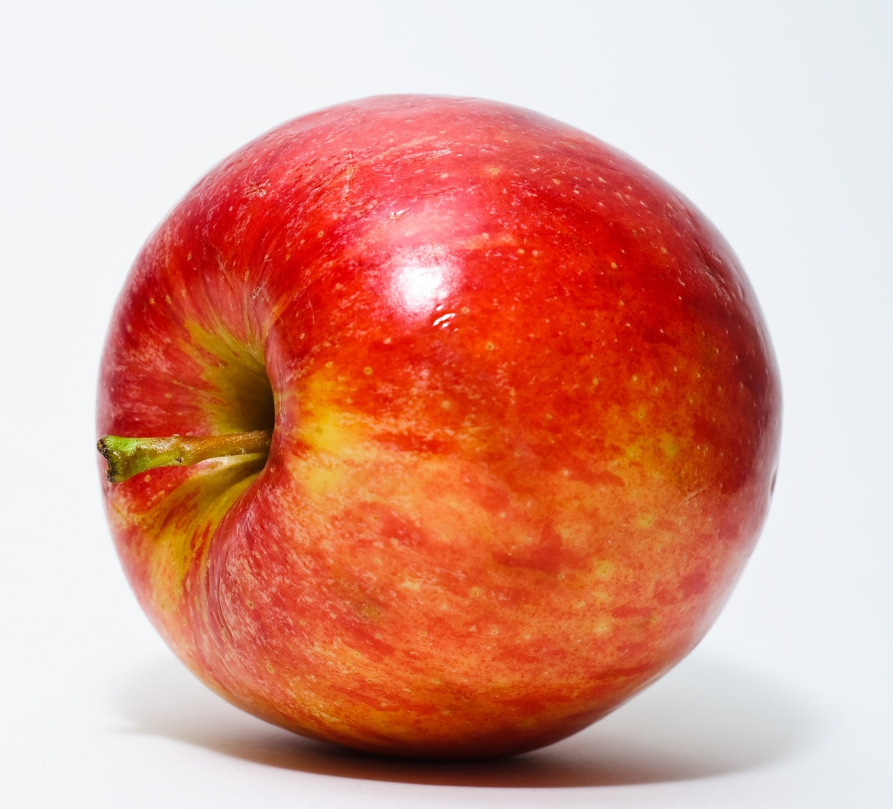

# Food, sleep, and recovery

AI-authored draft. Source-faithfulness and clinical review pending.

Lesson: `psa-education-03` · Topic: `education` · About 3 minutes

## Page 1

Nourishment focuses on food and nutrition needs. Food choices need to fit your own health and life. Food does not replace your prescribed PsA care. A dietitian can help with choices that fit your health, budget, and preferences. Ask about supplements or major diet changes before adding them to your care plan. The food chapter discusses vegetables, fruit, and sources of protein. Use these as topics to discuss with your team. It does not mean one food can switch off PsA. The lesson does not ask you to fast or follow a strict diet.

Meals can include a mix of vegetables, fruit, whole grains, and protein foods such as beans, fish, or poultry. The new food tables group meats as Land, Sea, and Sky; poultry and eggs are in Sky. These labels help find foods, not rank them as treatments. Choose foods that fit your needs, allergies, budget, and culture.

Abhijit Tembhekar; CC BY 2.0 (https://creativecommons.org/licenses/by/2.0/). Source: https://commons.wikimedia.org/wiki/File:Red_Apple.jpg. Downloaded original 2418 x 2192 photograph; resized to 1400 x 1269 and JPEG-compressed. No crop or added labels.

## Page 2

Repose focuses on rest and sleep. Pain or worry may make sleep harder, and poor sleep can make the next day feel harder to manage. Bring ongoing sleep problems to the care team. Describe whether pain, waking at night, or daytime tiredness is the main concern. Plans for meals, movement, coping, and rest should fit together. The aim is a manageable routine, rather than a strict rule for every day. Try to keep a steady time for bed and waking. A quiet, dark room and a calm wind-down routine may help. Let the team know if pain keeps waking you. Ask for help with sleep rather than changing your medicine on your own.

Keep a short sleep record to share at a visit. Note bedtime, wake time, waking in the night, pain, and how you feel the next day. Tell the team about loud snoring, gasping, or trouble staying awake by day. Good sleep habits may help, but ongoing sleep problems may need more care.

Ales Krivec; CC0 (https://creativecommons.org/publicdomain/zero/1.0/). Source: https://commons.wikimedia.org/wiki/File:Roman_numerals_on_alarm_clock_(Unsplash).jpg. Extracted from supplied RheumNotes PDF p. 19; resized and JPEG-compressed, no new crop or labels. Attribution transcribed from the supplied image appendix.

## Key takeaways

- Food does not replace your prescribed PsA care.
- Bring ongoing sleep problems to the care team.

## References and reviewer notes

General framework only. Fasting, elimination diets, alcohol advice, supplement doses, and disease-treatment claims are omitted.

- [The Four Pillars of Arthritis](../../../originals/The%20Four%20Pillars%20of%20Arthritis.docx) ? Nourishment paragraphs 10-38; Repose paragraphs 76-80; practical steps 85 (lesson pages 1, 2; text). Food discussions, steady sleep timing and a calm bedtime routine. Limits: No fasting, supplement doses, food-cure claims or extrapolated RA/OA treatment effects.
- [RheumNotes Nutrition White Paper 2026-11-17](../../../originals/RheumNotes_Nutrition_White_Paper_2026-11-17.pdf) ? PDF pp. 4, 10, 17-24: food groups and Land, Sea and Sky (lesson pages 1; text). Use the November 17 revision for food examples and protein table labels. The displayed apple is now sourced directly from the original photograph, not extracted from this PDF. Limits: RA diet trials, OA weight-loss effects, gout restrictions, nutrient doses and unverified guideline targets are not presented as PsA advice.
- [RheumNotes Sleep Restore White Paper](../../../originals/RheumNotes_Sleep_Restore_White_Paper.pdf) ? PDF pp. 19–21, 25–26, 29: sleep habits, help and diary; PDF p. 19: displayed illustration; Image Credits appendix (lesson pages 2; text_and_image). Add a simple sleep diary and concerns to report. Display the selected source image with attribution. Limits: No self-diagnosis, sleep restriction program, sleep medicine advice or rigid sleep target.
- [Red Apple ? original high-resolution photograph](../../../originals/supplementary/Red_Apple_high_resolution.jpg) ? Complete high-resolution Red Apple photograph; Wikimedia Commons file page (lesson pages 1; image). A clear example of fruit in a varied eating pattern; replaces the 241 x 180 PDF thumbnail. Limits: Illustrative food photo only; no claim that an apple treats PsA.
- [NHLBI: Sleep Diary](https://www.nhlbi.nih.gov/resources/sleep-diary)
- [NIAMS: Diagnosis, Treatment, and Steps to Take](https://www.niams.nih.gov/health-topics/psoriatic-arthritis/diagnosis-treatment-and-steps-to-take)
