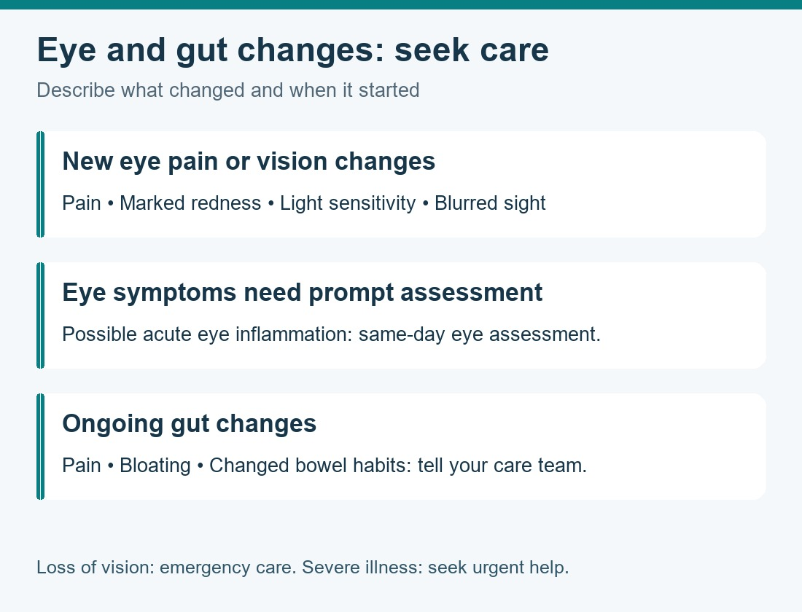

# Eye and gut changes to report

AI-authored draft. Source-faithfulness and clinical review pending.

Lesson: `psa-contact-02` · Topic: `contact` · About 2 minutes

## Page 1

Eye symptoms can need prompt attention. New eye pain, marked redness, light sensitivity, or blurred sight need urgent assessment. Guidance for possible acute eye inflammation calls for a same-day eye assessment. Seek emergency care for a loss of vision. These symptoms have several possible causes. An examination is needed to find the cause; the app cannot diagnose uveitis from symptoms.

Original editorial diagram summarizing the lesson and its cited sources, not a source screenshot. Clinical review pending.

## Page 2

Tell the care team about ongoing gut pain, bloating, or changes in bowel habits. Inflammatory bowel disease can occur alongside PsA, but a bowel change does not prove that it is the cause. Describe what changed and when. Your team can decide whether another assessment is needed. If symptoms are severe or you feel acutely unwell, seek urgent medical help. Do not wait for a routine visit to discuss an urgent eye problem.

The reporting guide helps you prepare a clear message. It cannot tell you the cause of a symptom. Use the care guidance above and the instructions from your own team.

## Key takeaways

- New eye pain, marked redness, light sensitivity, or blurred sight need urgent assessment.
- Seek emergency care for a loss of vision.

## References and reviewer notes

Generic urgency education based on NHS/NICE, adapted without UK telephone numbers. ACCR clinical review and local routing are still required. Added image-reading guidance and practical discussion prompts; prompts are editorial examples, not source quotations.

- [PsA One-Pager Intro](../../../originals/PsA%20One-Pager%20Intro.jpeg) ? Box B related conditions; Box C eyes and gut (lesson pages 1, 2; text). Identifies eye and bowel concerns alongside PsA. Limits: Same-day assessment and emergency advice come from NHS/NICE, not the source poster.
- [Clinical manifestations of PsA](../../../originals/clinical%20manifestations%20of%20PSA%20written%20at%20an%208th%20grade%20level.png) ? Eyes and gut cards; editorial diagram: eye-gut-reporting (lesson pages 1, 2; text_and_image). Plain-language eye and bowel symptoms to describe. Displays a lesson-specific editorial summary. Limits: Symptoms have multiple causes; poster cannot diagnose uveitis or IBD. Urgency wording in the editorial diagram follows the lesson NHS/NICE references, not the poster.
- [NHS: Uveitis](https://www.nhs.uk/conditions/uveitis/)
- [NICE NG65, recommendation 1.1.12: same-day eye assessment](https://www.nice.org.uk/guidance/ng65/chapter/recommendations)
